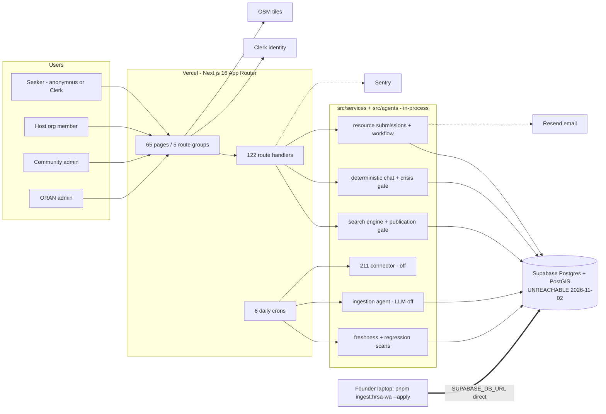
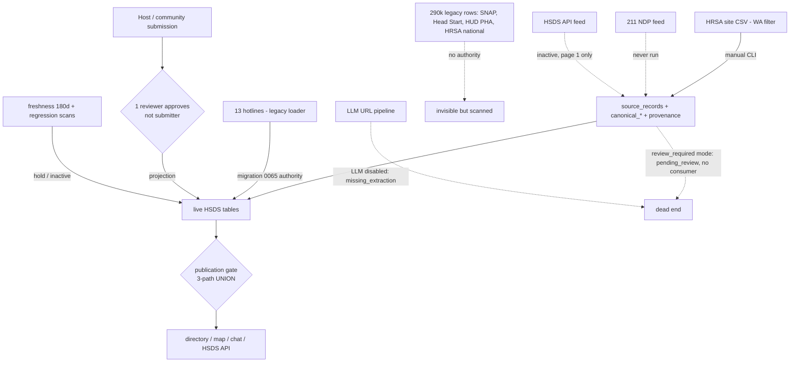
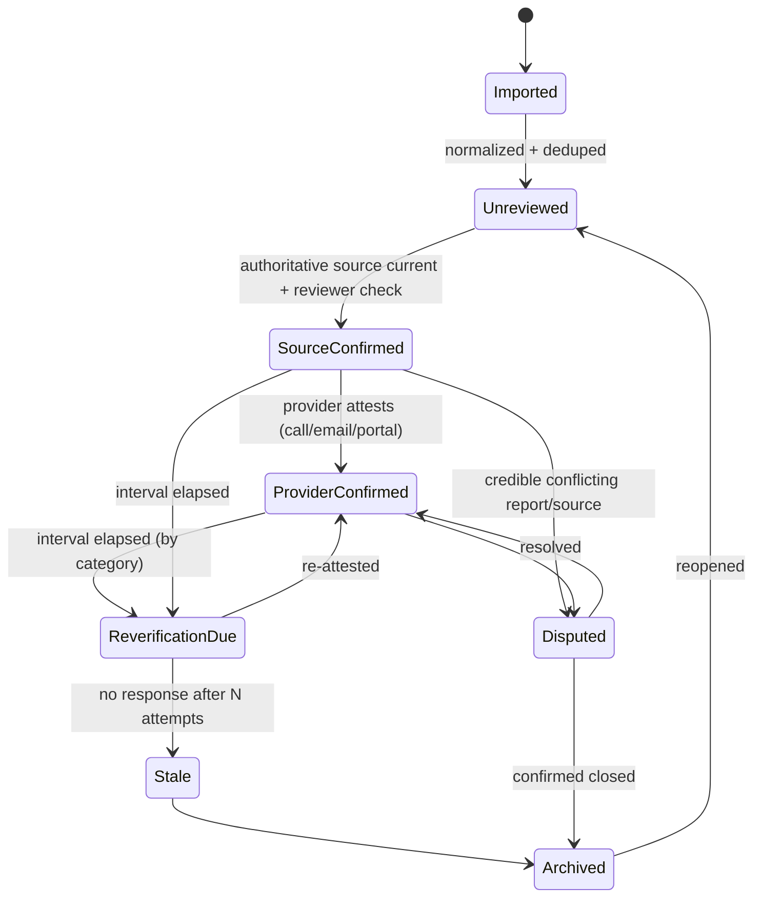

# ORAN Comprehensive Platform, Architecture & Resource Intelligence Audit

**Date:** 2026-11-02
**Revision audited:** `main` = `e0c9afd1646b6b23ee6b0bdc3c6bdbe003ec092c` ("feat: trusted recovery and categorical Azure retirement (#129)", 2026-08-09). This is also the release that production Sentry reports as currently deployed.
**Mode:** Read-only investigation. No application code, configuration, migration, or data was changed. No credentials were used or sought.
**Companion document:** [ORAN_AUDIT_FINDINGS_REGISTER_2026-11-02.md](ORAN_AUDIT_FINDINGS_REGISTER_2026-11-02.md) (actionable findings register, P0–P3)

> **How to read this report.** Every significant claim carries a confidence tag:
> **[Confirmed]** = observed directly in code, executed tooling, or a live public endpoint;
> **[Probable]** = strongly implied by code but not executed against a real database or production;
> **[Requires Verification]** = needs production access, credentials, or counterparties this audit did not have.
> File references are `path:line` at the audited revision. External sources were checked on 2026-11-02.

---

## 1. Executive summary and overall verdict

### The verdict in one paragraph

ORAN is a large, carefully guarded **platform shell** around a very small and, today, **unavailable** body of resource data. The repository has about 131k lines of application TypeScript, 99k lines of tests, 17.8k lines of SQL migrations, 42.7k lines of documentation, 122 API route handlers, 65 pages, and 4 role portals. It was built in about 5.5 months by one founder working with AI coding agents; GitHub Copilot authored 148 of 297 commits. Against that, the evidence shows this much real data: **458 published services**, which are 445 Washington HRSA health-center sites plus 13 national hotlines. They come from **one manually run import script**. No automated acquisition path has ever produced a published record. **On the audit date, production cannot reach its database**: `/api/health` returns `503 {"database":"unreachable"}`, service pages render "Could not load service", search answers "Rate limit exceeded", and the public status page says "All systems operational". Nothing in the repository would have alerted anyone.

The engineering is not careless; parts of it are unusually rigorous, including provenance, fail-closed publication, SSRF defense, a DB role model, migration verification, and account erasure. The problem is **proportion and sequencing**. Governance machinery was built for a national multi-source network before the platform had a single sustainable data source, a data partner, an operator, or users.

### Direct answers to the founder's questions

| Question | Answer |
| --- | --- |
| Where do ORAN's resources come from today? | One manual CLI import of HRSA health-center sites in Washington (445), plus 13 hotlines granted authority by a migration. Manual host/community submissions work in code, but production shows effectively none published (445 + 13 = 458 = sitemap count). 211, HSDS feeds, LLM crawling, and 11 federal-data scripts are **not producing published records**. [Confirmed for code; counts Confirmed by sitemap reconciliation] |
| Can ORAN legally and technically integrate with 211? | **Technically yes** (a connector exists, with two probably incorrect API assumptions). **Legally only per region**: the 211 National Data Platform requires the 211 that owns the data to request access for ORAN, under that 211's own data-sharing agreement. A 5% fee applies to revenue-generating use. No public, nationwide, unrestricted 211 API exists. ORAN has no evidence of any key or agreement. |
| How are resources manually added, reviewed, verified? | Hosts or community members submit through Resource Studio or forms. One community_admin or oran_admin (not the submitter) approves, and a projection writes live tables plus provenance. This works in code but is single-approver for new services, and has no provider outreach and no restore path. |
| What happens when information becomes outdated? | Mostly nothing until a hard cliff. Nothing re-runs the HRSA import. A daily scan holds records whose source is 180 days old, so the **entire governed supply goes dark around 2027-01-17**. One anonymous "fraud" report suppresses a listing. Nobody asks providers to confirm. |
| What is obsolete or unnecessarily complex? | Roughly half the system: the LLM ingestion/candidate layer (about 22k lines) that cannot run, the documented scoring engine that never executes, three parallel data models, 4 portals, dual data-access layers, inert feature flags, a hardcoded status page, about 22 API routes with no caller, and about 4.3k lines of unreachable modules. See §13. |
| Is the architecture suitable for a small team? | **No, not as built.** The stack choice (Vercel + Supabase + Clerk) is appropriate and cheap. The code volume, three overlapping data models, and policy and documentation machinery are not maintainable by one or two people, and the defects found show the code is not exercised against a real database. |
| What would make ORAN useful in one region? | A data partnership (WA211 or a county CIE) or a funded verification operation, plus 4 core categories in **one county**, with hours, intake method, and eligibility captured, reverified on a 90-day cycle, and measured by test-call accuracy. See §19–§20. |
| Does ORAN have a defensible position? | **Not yet.** Its plausible wedge is an open, provenance-transparent, privacy-respecting public discovery layer that *improves* 211 data rather than competing with it. Better design and "AI" are not differentiation. See §18. |

### Should you rebuild from scratch or fix what exists?

**Recommendation: do a controlled restart. Start a new, small codebase with an HSDS-native data model, and port a short list of proven components from this repository. Do not fix the current system in place, and do not do a blank-slate rewrite either.**

Why a restart is justified here (this is unusual advice, and it rests on specific facts):

1. **There is almost nothing to migrate.** The live production supply is 458 records, reproducible from an idempotent script (`scripts/import/hrsa-wa-release.ts`). There is no evidence of active users, partners, or revenue. The usual reasons not to rewrite (live users, irreplaceable data, revenue continuity) do not apply.
2. **The part you say will change, the acquisition and procurement approach, is the part the current schema is built around.** There are three parallel data models: live HSDS-ish tables, a source/canonical federation layer, and an LLM candidate layer. There are 77 migrations and a publication gate that is a three-way UNION across them (`src/services/search/publication.ts:50-207`). If the data strategy changes, most of the schema and the code that serves it change too.
3. **Fixing in place means repairing about 50 findings in code you will discard.** Many confirmed defects sit in subsystems that a new data strategy makes irrelevant: candidate publishing, scoring, feed modes, legacy tables.
4. **Maintenance load is out of proportion.** Roughly 270k lines of code, tests, and SQL, plus 42.7k lines of docs, for one founder is a permanent tax. The repository's own operating rules (single-writer lease, off-Azure static policy, runbook freshness, 7 agent personas) add process cost before product value.
5. **The volume was produced faster than it was verified.** Tests pass (4,452/4,452), but 111 test files mock the database and route tests mock the auth guards. So schema-level bugs ship, for example team invitations that cannot work (§15, ORAN-012). More code from the same method will not fix that.

Why not a blank-slate rewrite: several components are genuinely good and expensive to rediscover. Port them deliberately (§19.4). These include the HRSA importer's provenance and idempotency pattern, the SSRF-safe fetcher, the DB runtime-role model, the RLS deny-all backstop, the migration-verification harness, the seeker provenance display, the crisis-first gate structure (after fixing its patterns), and the CSP and header set.

Two conditions for the restart:

- **Do not start building until the data decision is made.** You need a signed or near-signed data relationship (for example WA211, or one county's CIE or United Way), or a funded plan to verify records yourself. Build to that source.
- **Cap scope deliberately.** For the first regional release, target about 10–15% of the current code size: one seeker app, one operations console, an importer per source, and an HSDS 3.3 API. Add provider self-service only after the pilot shows demand.

Meanwhile, the current production deployment needs a minimal, honest stabilization: restore the database or put up a truthful maintenance notice, patch Next.js, and correct the privacy policy and status page (§20, Horizon 1). That holds whatever you decide.

### Executive scorecard

**Scale:** 0 = absent · 1 = documented or conceptual only, or code exists but not operating · 2 = prototype or partial, works in limited paths · 3 = functional end-to-end but unproven in production · 4 = operating in production with known gaps · 5 = mature, measured, monitored.

| Category | Score | Evidence basis |
| --- | --- | --- |
| Product completeness | 2 | Broad surface; most features "functional but incomplete" or partial (§12) |
| Real resource availability | 1 | 458 records, one category-heavy source, one state; **0 reachable on audit date** (§4, §6) |
| Resource acquisition automation | 1 | Connectors exist; no automated path publishes (§6) |
| Resource data quality | 1 | Strong provenance, thin content: HRSA records lack hours, eligibility, languages (§9) |
| Reverification maturity | 1 | Scans exist; no provider outreach; 180-day cliff; single-report suppression (§9) |
| External integration maturity | 1 | 211 connector never run; no agreements (§7) |
| Administrative operations | 2 | Review queue and projection work in code; single approver; no restore; invites broken (§8) |
| Search and matching | 2 | Deterministic, publication-gated; ranking by intake channel, no text relevance, service areas ignored (§11) |
| Security and privacy | 2 | Good primitives; privacy-policy misstatements, WA MHMDA exposure, critical framework CVEs (§15) |
| Architecture maintainability | 1 | Three parallel models, dual DB layers, about 270k lines for one founder (§14) |
| Testing and reliability | 2 | 4,452 passing tests but DB and auth mocked; prod outage undetected (§16) |
| Production readiness | 1 | Deployed, but primary function down; no uptime monitoring; DR undrilled (§4, §16) |
| Market differentiation | 1 | Hypotheses only; none evidenced (§18) |
| Institutional/commercial readiness | Not Verified | No partner, agreement, pilot, or customer evidence in the repository; may exist off-repo |

---

## 2. Exact repository revision and audit scope

| Item | Value |
| --- | --- |
| Repository | `AutomatedEmpires/Open-Resource-Access-Network` |
| Default branch / SHA | `main` @ `e0c9afd1646b6b23ee6b0bdc3c6bdbe003ec092c` (2026-08-09) |
| History | 297 commits, 2026-02-27 → 2026-08-09; 28 (Feb), 228 (Mar), 0 (Apr–Jun), 36 (Jul), 5 (Aug). No commits for 85 days before the audit. |
| Authorship | GitHub Copilot 143 + copilot-swe-agent 5; Jackson Cole 116; dependabot 32; imgbot 1 |
| Size | 1,492 tracked files; 122 route handlers; 65 pages; 40 `src/services` subdomains; 77 migrations (+3 `.sql.deprecated`), 17,845 SQL lines; 425 test files; 189 doc files (42,742 lines) |
| Operating contract | `AGENTS.md` (providers fixed: Supabase, Clerk, Vercel; Azure "retired and prohibited"; AI disabled by default) |

**Executed in an isolated container (results observed):**

| Command | Result |
| --- | --- |
| `npm ci` | success (941 packages) |
| `npx tsc --noEmit` | exit 0 |
| `npx eslint` | exit 0 — 0 errors, 21 warnings (unapproved Tailwind arbitrary values) |
| `npx vitest run` | **414 files, 4,452 tests, all passed** (163.6 s) |
| `npm audit --omit=dev` | **15 vulnerabilities: 2 critical, 7 high, 6 moderate** |

**Live read-only checks of public production URLs** (via a public scraping service, because the sandbox's egress policy blocks the domain directly):

| URL | Observed 2026-11-02 |
| --- | --- |
| `/api/health` | HTTP 503 `{"status":"unhealthy","database":"unreachable"}` |
| `/directory` | HTTP 200, renders the search shell; Sentry baggage `release=e0c9afd…`, `environment=production` |
| `/service/0192220d-…` | HTTP 200 with body "Could not load service / Failed to fetch service" |
| `/api/search?q=food` | HTTP 429 "Rate limit exceeded. Please wait before searching again." |
| `/sitemap.xml` | 478 URLs, of which **458 `/service/*`**, all `lastmod 2026-08-09T21:09:58Z` (cached from the last successful generation) |

**Not available to this audit:** production database, Vercel/Supabase/Clerk/Sentry dashboards, GitHub branch-protection settings, secrets, partner correspondence, analytics, and billing. Everything that depends on them is marked [Requires Verification].

**Execution method.** Five independent investigators covered (1) architecture and legacy code, (2) acquisition and data model, (3) external 211/standards/competitor research, (4) security, CI, and ops, and (5) search and matching. The lead auditor then re-verified the highest-impact claims in code (crisis classifier precedence, invite constraint violation, feed-poll gate, fraud threshold, staleness constants, direct-write location route, rate-limit fail-closed behavior, status page) and reconciled conflicting statements. Reconciliations are noted inline.

---

## 3. What ORAN genuinely does today

| Claimed (docs/README) | Actually true in code / production |
| --- | --- |
| "Verified" resource matching platform | A publication-gated directory of 458 records (445 WA health centers + 13 hotlines). **Unreachable on 2026-11-02.** |
| "Deterministic trust and match scoring": `0.45·verification + 0.40·eligibility + 0.15·constraint` | The scorer (`src/services/scoring/scorer.ts`) has **no production caller**. Stored scores are constants by intake channel: HRSA 90, host 92, community 85, community-queue approvals 80/50/50, ingestion `eligibility = constraint = 0`. [Confirmed] |
| Eligibility match | No eligibility engine. Age and household fields are displayed, never compared. Onboarding answers become free text and are not used for matching. [Confirmed] |
| Source-driven ingestion, 211 federation | 211 connector written, never run; default feed mode leads to a state nothing consumes; LLM pipeline cannot build candidates with AI disabled. [Confirmed] |
| Reverification: "stale listings move back into review" | Freshness and regression scans move records *out* of public view. No re-acquisition or provider confirmation exists. [Confirmed] |
| Multilingual (6-locale switcher) | About 60–78 keys per locale, used only by nav and footer; discovery, chat, and the crisis banner are English-only. [Confirmed] |
| Status page "All systems operational" | Hardcoded (`src/app/(public)/status/page.tsx:27-34`). [Confirmed] |
| pgvector / semantic search (README architecture diagram) | `hybridSearch` reached only by tests; nothing generates embeddings. [Confirmed] |
| "Crisis hard gate" | Real and runs before rate limits, but its classifier has precedence and coverage holes (§11.4). [Confirmed] |
| Privacy: approximate location by default | True: coordinates rounded to about 1 km. But the privacy policy understates stored sensitive data (§15). |

**What is genuinely strong:** the deterministic, publication-gated retrieval; seeker-visible provenance that only uses evidence (`src/services/provenance/publicProvenance.ts`); the HRSA importer's provenance chain and idempotency; the SSRF-safe outbound fetcher; the fail-closed DB role model; transcripts kept client-side; local-first saved items; and honest seeker copy ("Who may qualify", "Eligibility not guaranteed"; no "you qualify" or "open now" claims).

---

## 4. Production and infrastructure status

### 4.1 Production is down for its primary function [Confirmed]

- `/api/health` → 503 `database: unreachable`. Per `src/app/api/health/route.ts:42-99`, this branch means the env contract validated, the project ref parsed, and the DB is configured, but `SELECT 1` failed. So the deployment is configured; the database is not answering.
- Probable causes [Requires Verification]: a paused or suspended Supabase project (for example, an inactive free-tier project, or a billing hold), rotated or revoked credentials for `oran_backend_runtime`, or a network or pooler change.
- **User-facing masking.** The shared rate limiter fails closed in production when the database errors (`src/services/security/rateLimit.ts:203-210`, `unavailableRateLimitState` at `:171-186`). So search returns HTTP 429 with "Rate limit exceeded. Please wait" (`src/app/api/search/route.ts:81-92`). A person in need is told to wait, not that the service is down.
- **No detection.** No workflow monitors production health (`.github/workflows/*` contains no uptime check). The status page is static. There are no Sentry cron check-ins. If Sentry alert rules exist they are configured outside the repo [Requires Verification].
- **Soft-404s.** Service pages return HTTP 200 with an error body; the cached sitemap still advertises 458 URLs.

### 4.2 Active infrastructure (current)

| Service | Role | Wired? | Notes |
| --- | --- | --- | --- |
| Vercel | Hosting, deploy-on-merge, 6 crons (`vercel.json`) | Yes (Sentry release tag observed) | Frontend serving; crons depend on the DB |
| Supabase Postgres + PostGIS | Sole datastore | Configured; **unreachable** | App connects as `oran_backend_runtime` (BYPASSRLS + per-table grants, migration 0066); RLS enabled with zero policies as a deny-all backstop (0075) |
| Clerk | Identity only; roles live in DB (`user_profiles`, `organization_members`) | Yes (CSP, middleware) | Fails closed on DB error |
| Sentry | Errors and tracing (0.05) | Yes (observed) | Scrubbing incomplete (§15) |
| Resend | Submission-status email only | Configured in env contract | Profile email preferences have no producer |
| OpenStreetMap tiles | Map tiles, direct from `{s}.tile.openstreetmap.org` (`src/components/map/LeafletFallback.tsx:222`) | Yes | OSMF policy: no SLA, may block; deprecated subdomain URL form |
| Nominatim (public) | Geocoding at ingestion publish | Optional | No 1 req/s throttle; bulk use violates its policy |
| Redis (ioredis) | Optional cache/limiter | **Dead in production** (`rateLimit.ts:207`; `REDIS_URL` absent from production settings) | Removal candidate |
| Anthropic | Optional ingestion assist | Disabled (`LLM_PROVIDER=disabled`) | No seeker dependency |
| 211 NDP | Optional feed | Disabled (`NDP_211_POLLING_ENABLED=false`, no key) | Never run |
| Supabase Data API (PostgREST) | Reserved | `NEXT_PUBLIC_SUPABASE_*` required by env contract and allowed in CSP, but **no Supabase client exists** | Remove from contract or document |

### 4.3 Production vs development

| Aspect | Production | Development / CI |
| --- | --- | --- |
| DB | Supabase pooler :6543, `sslmode=require`, fixed role enforced (`runtimeRole.ts`) | Local or disposable Postgres (`scripts/db/disposable-postgres.sh`); unit tests mock `pg` |
| Rate limiting | Postgres function (fail-closed) for 67 routes; **in-memory per instance** for 41 routes | Redis or memory |
| Migrations | Manual `db-migrate.yml` dispatch, founder-gated; **decoupled from deploy** | CI "Migration Verification" on a fresh Supabase Postgres image (not a required check) |
| E2E | None runs against prod | CI runs only visual regression with `DATABASE_URL=""` |

### 4.4 Active vs historical architecture

| Era | Stack | Status |
| --- | --- | --- |
| Feb–Mar 2026 | Azure App Service, Azure Functions (10), Bicep, Entra ID via NextAuth, Azure OpenAI, Azure Maps, Azure Translator, Azure Speech, App Insights, ACS email | Removed. NextAuth and Azure email removed 2026-07-15 (`5dd52a5`); surfaces archived 07-16 (`26b90cb`); Functions, Bicep, deploy workflows, and AI adapters deleted 08-09 (`e0c9afd`). |
| Jul–Aug 2026 | Vercel + Supabase + Clerk + Sentry + Resend | Current |
| Remnants in `src/` | 4 tombstone routes returning 410 (`maps/token`, `tts/summary`, `admin/embeddings/reindex`, `candidates/[id]/ai-review`); `'azure_function'` feed-handler enum; 9 retired flags forced off; boot-time provider-policy guard | Low risk; listed in register |

**Doc/contract conflicts:** `AGENTS.md` says the off-Azure migration "landed 2026-07-15", but Azure AI adapters stayed in `src/` until 08-09. `AGENTS.md` also says `pnpm`, while the repo uses `npm` (`package-lock.json`). `docs/CONVERGENCE.md:322-345` still says the 290k-row July load passes the gate; it does not (§6). `docs/DECISIONS/ADR-0002-azure-native-integration-plan.md` still contains personal contact details and should be redacted.

### 4.5 Provider cost and complexity

Public list prices (2026-11-02; not verified current charges):

| Provider | Likely tier | List price |
| --- | --- | --- |
| Vercel | Pro (Hobby is non-commercial) | $20/seat/mo incl. $20 usage credit ([vercel.com/pricing](https://vercel.com/pricing)) |
| Supabase | Pro (avoids inactivity pausing) | from $25/mo ([supabase.com/pricing](https://supabase.com/pricing)) |
| Clerk | Free ≤50k retained users | $0; Pro $25/mo ([clerk.com/pricing](https://clerk.com/pricing)) |
| Sentry | Team | $26/mo ([sentry.io/pricing](https://sentry.io/pricing/)) |
| Resend | Free 3k/mo or Pro | $0–$20/mo ([resend.com/pricing](https://resend.com/pricing)) |
| Tiles | OSM (free, no SLA) or MapTiler Flex | $0 or $30/mo ([maptiler.com](https://www.maptiler.com/cloud/pricing/)) |
| Geocoding | US Census batch geocoder | $0 ([census.gov geocoder](https://geocoding.geo.census.gov/geocoder/)) |

Modeled baseline is about **$90–$120/month** before overages. Infrastructure is not the cost problem (§17). Operational complexity, however, is high relative to the stack. The complexity is self-imposed: the policy scripts, eight workflows, the lease protocol, and 189 docs.

---

## 5. Architecture and dependency diagrams

### 5.1 Current architecture (as executed)

### 5.2 Data flow from acquisition to discovery (actual)

---

## 6. Resource acquisition inventory (highest priority)

### 6.1 Bottom line

**ORAN does not have a sustainable source of information today.** Seeker-visible supply comes from exactly three paths [Confirmed: `src/services/search/publication.ts:50-207`]:

1. **HRSA Washington release** (`scripts/import/hrsa-wa-release.ts`): a founder-run CLI writing directly via `SUPABASE_DB_URL`. It has excellent provenance (UUIDv5 IDs, payload SHA, drift guards, withdrawn-site holds), but **thin content**: name, address, phone, URL, and "contact the site to confirm hours, costs, eligibility" (`src/services/ingestion/hrsaWa.ts:432-441`). Confidence is hardcoded at 90. **No scheduler.** HRSA republishes monthly (its CSV was updated 2026-11-01 per [data.hrsa.gov](https://data.hrsa.gov/topics/health-centers)); ORAN's copy dates from 2026-07-21.
2. **Manual submissions**: complete in code; production volume effectively zero (reconciliation below).
3. **13 national hotlines**: authority granted by `db/migrations/0065_verified_hotline_authority.sql`. **They cannot be rebuilt on a fresh or restored database**: the only producer (`scripts/import/seed-resources.mjs`) now refuses writes (`:46-58`).

**Reconciliation.** The docs claim 445 HRSA services (`docs/platform/STACK_MIGRATION.md:35`). With the 13 hotlines that makes 458, which **exactly** equals the 458 `/service/*` URLs in the production sitemap generated 2026-08-09. So, as of the last successful generation, approved manual submissions contributed essentially nothing. [Probable; the sitemap caps at 500, so the count is not truncated]

### 6.2 Source-by-source inventory

| # | Mechanism | Status | Source / owner | Refresh | Automated? | Idempotent / dedup | Provenance | Failure behavior | Published records |
| --- | --- | --- | --- | --- | --- | --- | --- | --- | --- |
| 1 | HRSA WA release | **Operational (manual)** | HRSA (US gov, no usage limits) | None since 2026-07-21 | No | Yes (UUIDv5, SHA, ON CONFLICT) | Strong, per field | Transaction aborts on drift | ~445 (claimed; reconciled) |
| 2 | Host / community submissions | **Operational (code)** | Submitting org | On demand | Human | Name/URL match only | Submission assertion + snapshot | Projection repair path | ≈0 evidenced |
| 3 | 13 national hotlines | **Historical + static authority** | Public facts | Never | No | Exact-UUID guard | Migration-asserted | **Not rebuildable** | 13 |
| 4 | 211 National Data Platform | **Configured but inactive** | Each regional 211 | Would be daily cron | Gated off | Payload SHA | Tier/family signals | Errors in feed state; no alert | 0 |
| 5 | Generic HSDS API feed | **Partially implemented** | Any HSDS publisher | Cron (gated) | Gated off | SHA; **first page only** | — | errors collected | 0 |
| 6 | LLM URL pipeline / ingestion campaign | **Configured but inactive** | Crawled websites | Manual | No | sha(url, content) | Evidence snapshots | `missing_extraction` without LLM (`stages.ts:347-351,892-898`) | 0 |
| 7 | Pipeline demo | **Historical** (ran on Azure OpenAI, March) | — | — | — | — | — | — | 0 persisted |
| 8 | Legacy bulk loader `seed-resources.mjs` | **Historical; write-disabled** | Mixed federal | — | — | UUIDv5 | **None** (direct live writes) | — | 290,056 loaded, none visible |
| 9 | USDA SNAP retailers | **Historical, quarantined** (254,048 rows) | USDA | — | — | — | — | Gate excludes signature | 0 (correctly: stores are not services) |
| 10–12 | HRSA national, Head Start, HUD PHA | **Historical, invisible** (~36k rows) | Federal | — | — | per-batch | none | Still scanned by regression jobs | 0 |
| 13 | HUD Housing Counseling | **Broken** (HTTP 500 noted in `CONVERGENCE.md:374-376`) | HUD | — | — | — | — | — | 0 |
| 14–19 | SAMHSA, NPPES, IRS BMF, Socrata harvest, College Scorecard, ArcGIS | **Unknown / stranded**: scripts emit NDJSON; their only loader is disabled | Federal / local | — | — | — | — | — | 0 |
| 20 | HSDS CSV importer | **Mocked / stub** ("TODO … Would stage", `db/import/hsds-csv-importer.ts:533-599`) | — | — | — | — | — | — | 0 |
| 21 | Legacy `feed_subscriptions` poll | **Stub** (stamps a timestamp only) | — | — | — | — | — | — | 0 |
| 22 | Demo seed (`db/seed/demo*.sql`) | **Mocked, dev-only, no prod guard** | Fictional | — | — | — | Fake `verified_publisher` | Would publish 5 "[DEMO]" services at 0,0 if applied | 0 (not wired) |

### 6.3 Acquisition workflows that look real but never produce usable records

- **Feed polling cron**: returns `skipped` unless `SOURCE_FEED_POLLING_ENABLED`, which is not even in `.env.example` (`src/app/api/internal/ingestion/feed-poll/route.ts:24-31`). [Confirmed]
- **Default `review_required` feed mode** sets canonical rows to `pending_review`, and nothing in `src/app` reads that state. [Confirmed]
- **Feed updates hide existing listings**: polls pass `allowRepublish: false`, so an upstream change to an already-published record demotes it to `pending_review` and it vanishes. [Probable]
- **211 and HSDS child records become bogus entities**: location and service-at-location records are normalized as organizations named after the location. No taxonomy crosswalks are seeded. [Probable]
- **Candidate publishing** requires migration 0078 activation plus two independent approvals, and **no UI calls the publish endpoint**. [Confirmed]
- **Coverage-gaps cron** measures reviewer coverage of LLM candidates, not resource coverage, so it is effectively a no-op. [Confirmed]

### 6.4 Sustainability judgment

ORAN currently depends on the founder manually running one federal import. The architecture *anticipates* federation, but no data relationship, scheduler, or operator exists to make it real. Without one of these, ORAN is a self-maintained directory with no maintenance operation:

- a 211 data partnership;
- a CIE participation agreement;
- a funded verification team.

---

## 7. 211 and external integration feasibility

### 7.1 What ORAN has

`src/agents/ingestion/ndp211Connector.ts` (+ `ndp211Types.ts`, `ndp211Normalizer.ts`, `scripts/bootstrap-source-feed.mjs`, `scripts/run-211-canary-report.mjs`) targets `https://api.211.org/resources/v2` with an `Ocp-Apim-Subscription-Key` header (`:99`) and an optional `dataOwners` header (`:101-102`). It discovers via `GET /search` (`:349-357`), then `GET /export/organizations/{id}`. `docs/ops/services/RUNBOOK_211_API_INGESTION.md:11` says no production canary was accepted. **No evidence of any key, agreement, or ingested 211 record.** [Confirmed]

**Assumption check against public evidence:**

| Assumption | Assessment |
| --- | --- |
| Base URL and APIM key header | Probably correct: the portal runs on Azure API Management, and third-party public code calls `/resources/v2/search/keyword` with that header |
| Sending `dataOwners` | **Probably incorrect.** The repo's own archived portal notes say the header "is used to configure policies, and should be left blank by data consumer" (`docs/_archive/2026-03/working-notes/211_info_001.md:25-28`). Data visibility is set by the API product United Way provisions for the key. |
| Bare `GET /search` discovery | **Probably incorrect.** Publicly visible V2 search is `/search/keyword?keywords=&location=`; bulk listing belongs to Export V2 (definitions visible only after sign-in). |
| Pre-check | Requires Verification with a Trial key |

### 7.2 What the 211 ecosystem actually offers (verified 2026-11-02)

- **Operator:** the 211 National Data Platform (NDP) is "funded and managed by United Way Worldwide" and aggregates local 211 data, "made available to authorized users through APIs" ([register.211.org FAQ](https://register.211.org/Home/FAQs)). V2 APIs (Search, Export, Query, Suggest, Filter, EPIC) are "in preview" ([apiportal.211.org](https://apiportal.211.org/)). Self-reported scale: "240+ 211s", "2 million resources", "96% United States coverage" (marketing).
- **Ownership:** "211s retain ownership of any data they originate"; data owners "can withdraw data from Platform at any time" ([NDP Snapshot PDF](https://register.211.org/files/211%20NDP%20Snapshot.pdf)).
- **Access path:** the Trial product gives limited data. Production access begins when the **owning 211 submits the API Request Form**, and the 211 "dictate[s] and manage[s] the financial and data sharing relationship" (FAQ / Snapshot).
- **Cost:** sharing and internal use are free. For revenue-generating use, "United Way Worldwide charges a fee of 5% of the data valuation within the contract" (FAQ). Individual 211 fees are not publicly documented.
- **Update cadence:** set by each 211, ranging from daily to monthly; weekly is recommended (FAQ).
- **Rate limits, redistribution, attribution:** not publicly documented; governed by per-211 agreements. Templates are in the [211 Toolkit Document Library](https://211toolkit.unitedway.org/content/document-library).
- **Taxonomy (211HSIS, formerly AIRS/211 LA):** licensed. List prices are $200/yr (nonprofit or government), $500/yr (for-profit), and $5,000/yr (licensed API user) ([211hsis.org/pricing](https://211hsis.org/pricing)). The terms forbid distributing content to third parties or making derivative works without permission ([terms](https://211hsis.org/terms-of-use)). The licence FAQ says storing the term name and code indexed to a resource does not violate the agreement ([FAQ PDF](https://211hsis.org/library/Subscriber_API_Activity_FAQ.pdf)). **Implication:** ORAN may keep codes as received, but must not publish the taxonomy tree or definitions (for example in HSDS taxonomy exports) without a licence.
- **Open Referral HSDS:** latest release v3.3.1 (2026-09-09) ([GitHub release](https://github.com/openreferral/specification/releases/tag/v3.3.1)). Since 3.0 the API spec is part of HSDS. A profile-aware validator exists ([ORUK validator](https://github.com/OpenReferralUK/oruk-validator)). HSDS is a **standard, not a data source**; live US HSDS endpoints are scarce, and NDP V2 is its own shape.

### 7.3 Regional reality: Washington

- **WA211** reports about 17,000 services ([wa211.org](https://wa211.org/)), about **37× ORAN's entire supply**. It runs on Connect 211, an open-source 211 front end ([github.com/211-Connect](https://github.com/211-Connect)).
- WA211's 2025 assessment reports a "66% reduction in funding from the Legislature for 2025-2027", consolidation from 7 call centers to 1, and an aim to "be positioned to participate in national data initiatives" ([Executive Summary PDF](https://wa211.org/wp-content/uploads/2025/07/Executive-Summary-7725.pdf)). This **suggests WA211 may not yet be on the NDP** [Requires Verification]. It also signals both a need for help and limited capacity to take on partners.
- **Washington CIE:** the Health Care Authority's Community Information Exchange, led by Comagine Health, includes a resource directory and targets a first technology launch in summer 2027 ([HCA CIE](https://www.hca.wa.gov/about-hca/programs-and-initiatives/medicaid-transformation-project-mtp/community-information-exchange-cie), [FAQ PDF](https://www.hca.wa.gov/assets/program/wa-cie-faq.pdf)). This is the state-level institution ORAN must align with or be displaced by.
- Other examples: 211 San Diego's CIE (6,000+ resources) ([ciesandiego.org](https://ciesandiego.org/cie-participants/)). 211info (Oregon) data now powers a public statewide directory run by Unite Us, launched 2026-02-02 ([Unite Us press](https://uniteus.com/press/oregon-health-leadership-council-211info-and-unite-us-expand-public-access-to-community-resources-with-statewide-directory-launch/)). That is precisely ORAN's proposed role, already filled by an incumbent in a neighboring state.

### 7.4 Comparative integration matrix

| Source | Feasibility | Reach | Licensing / redistribution | Access | Difficulty | Update freq. | Maintenance | Value |
| --- | --- | --- | --- | --- | --- | --- | --- | --- |
| 211 NDP via WA211 | Medium-low (gated) | Per data owner | Per-211 agreement; 5% UWW fee on revenue use | Owning 211 submits request form | Medium (connector exists; fix discovery/header) | Daily–monthly | Medium (V2 in preview) | **Very high** if WA211 participates |
| WA211 direct export (Connect 211 / vendor) | Medium | WA (~17k) | Not public; written DSA needed | Direct agreement | Medium | WA211-set | Medium | Very high |
| WA CIE (HCA/Comagine) | Low now, medium 2027+ | WA | Governance TBD | Program participation | Unknown | — | — | High, strategic |
| 211HSIS taxonomy licence | High (buyable) | n/a | Restrictive | $200–$5,000/yr | Low | — | Low | Medium |
| HSDS 3.3 export + validator | High | n/a | Open spec | None | Medium | — | Low | High (interoperability credibility) |
| HRSA sites | High (exists) | National | US gov | None | Low | ~Monthly | Low | High (health only) |
| SAMHSA FindTreatment | High | National | US gov; [API request form](https://findtreatment.gov/api-request-form) | Registration | Low | Not stated | Low | High (behavioral health) |
| Head Start locations | High | National | US gov | None | Low | Not stated | Low | High (childcare) |
| HUD housing counselors / PHAs | High | National | US gov | None | Low | Not stated | Low | Medium |
| WA Dept. of Agriculture food banks | Medium | WA | State site terms (unchecked) | Request or extract | Medium | Unknown | Medium | High for pilot |
| IRS EO BMF (`eo_wa.csv`) | High | State files | US gov | None | Low | Monthly | Low | Low (org identity only) |
| NPPES / College Scorecard | High | National | US gov | None | Low–Med | Varies | Low | Low |
| USDA SNAP retailers | High | National | US gov | None | Low | Frequent | Low | **Negative as services**; attribute only ("accepts EBT") |
| ArcGIS/Socrata harvests | Medium | Patchy | Per dataset | None | Medium | Varies | High | Medium |
| Findhelp | Low | National | ToS forbids "data mining, robots" ([terms](https://company.findhelp.com/cbo-terms/)); paid API | Customer contract | — | — | — | Do not use |
| Unite Us | Low | Network states | Closed | Customer contract | — | — | — | Do not use |

### 7.5 Recommended integration strategy

1. **Before any code:** approach WA211 with a no-cost offer that fits its funding situation. ORAN would act as a public HSDS discovery layer and a stale-record feedback channel to WA211's data curators, with prominent WA211 attribution. Ask whether WA211 participates in the NDP. If yes, ask it to submit the API Request Form naming ORAN. If no, ask for a periodic HSDS export under a written data-sharing agreement (DSA). Get answers in writing on redistribution, display, derivative use, attribution, and withdrawal.
2. Register a developer account and Trial key to obtain the real V2 definitions. Turn them into contract tests. Fix `dataOwners` and the discovery call. Do not claim production access.
3. Until a 211HSIS licence is in place: store taxonomy codes only as received, never publish the taxonomy, and export ORAN's own category set.
4. Build a 211-independent baseline for the pilot county from authoritative federal sources: HRSA, SAMHSA (file the request form), Head Start, HUD counselors, hotlines, and WSDA food banks. Treat SNAP as an attribute and IRS BMF as identity only.
5. Engage the WA CIE program now. Position ORAN as an HSDS-conformant directory contributor or public front end, not a competing exchange.
6. **Conflict handling across directories:** keep per-field provenance (already modeled) and use field-level precedence. Order: the provider's own confirmation first, then the 211 curator, then a federal registry for identity and location, then community reports, which act as triggers rather than overwrites. Surface disagreements to reviewers rather than auto-merging. Show seekers the source and date per field.
7. **Effort (modeled):** connector fixes and contract tests 1–2 weeks; normalization to an HSDS-native model 2–4 weeks; ongoing work about 0.1 FTE for feed monitoring plus relationship management. Licence costs are $0–$5,000/yr plus any 211 fee (not public).

---

## 8. Manual resource submission and administration

| Capability | Present? | Evidence / notes |
| --- | --- | --- |
| Admin create | Yes (via Resource Studio / submissions) | `src/services/resourceSubmissions/service.ts:1131,1196,1640` |
| Org self-submission | Yes | `api/host/services/route.ts:319-366` |
| Public "suggest a resource" | Yes | `api/resource-submissions`, `(seeker)/submit-resource` |
| Claim existing entry | Yes (through resource submissions); `host/claim` route is e2e-only | approval requires oran_admin |
| Review required | Yes | community_admin+ (`resource-submissions/[id]/route.ts:169-178`) |
| Audit trail | Yes | `submission_transitions`, `lifecycle_events`, `audit_logs`, versioned snapshots |
| Server-side permission enforcement | Yes, generally | Every `/api/admin/**` and `/api/community/**` handler checks role; `/api/internal/**` uses timing-safe secret compare |
| Two-person approval | **Off for new services** | `two_person_approval` seeded false (`0035_feature_flag_catalog.sql:13`); `new_service` excluded from the two-person list (`src/domain/constants.ts:214-219`); missing-row default is true (`workflow/engine.ts:120-127`), an inconsistency |
| Reject invalid input | Yes (zod) | — |
| Duplicate detection | Weak: exact name/URL match | `resolveExistingEntitiesForDraft` (`service.ts:165-187`); merge API exists but has **no UI** |
| Merge without losing provenance | Backend only | `api/admin/merge/*` |
| Correct entries | Yes (queued for active services) | `host/services/[id]/route.ts:297-350` |
| Archive / close | Yes (→ `defunct` on approval) | no "temporarily closed" status |
| Restore / history inspection | **No restore route**; snapshots exist | — |
| Team invites | **Broken** | inserts `NULL` or `'pending_invite'` into `organization_members.status NOT NULL CHECK IN ('invited','active','deactivated')` (`api/host/admins/route.ts:250-266`; `0006_org_members_and_profiles.sql:16-17`) [Confirmed] |
| Live-data bypass | **Yes** | `PUT/DELETE /api/host/locations/[id]` writes live `locations` (including lat/lng) or sets `defunct` with no review (`route.ts:139-235, 351-401`), contradicting UI copy (`LocationsPageClient.tsx:160`) [Confirmed] |
| Sensitive info protection | Partial | see §15 |

**Can a small team maintain thousands of resources?** Not with these tools. There are four bottlenecks:

1. Every change needs a human reviewer, but nothing prioritizes the queue by risk or staleness.
2. There is no provider outreach, so reverification is purely reactive.
3. Freshness and regression scans generate junk tasks, because they scan about 36k invisible legacy rows oldest-first.
4. Four portals (host, community, ORAN admin, plus seeker) split one operator's work across 30+ screens.

A single operations console with a prioritized work queue would serve a 1–3 person team better. Prioritize by: categories and records due for reverification, user reports, and source changes.

---

## 9. Reverification and data-quality assessment

### 9.1 What is recorded today

| Field | Recorded? |
| --- | --- |
| Original source, import date, last refresh | Yes (canonical/provenance layer: `source_records`, `canonical_provenance`, `last_refreshed_at`) |
| Source publication date | Partially (snapshot metadata) |
| Last manual review | Via submission transitions |
| Last provider confirmation | **No** |
| Verification method / scope / expiry | **No** structured fields |
| Program availability, intake status, capacity | `capacity_status` column exists (`0013:35`, default `available`) but is **never selected** by search |
| Eligibility, service area | Tables exist; eligibility display-only; service areas unused in search |
| Conflicting source info | Per-field provenance and resolution tables exist; no automated cross-source merge |
| Failed verification attempts | No |

### 9.2 Freshness and quality logic

- `src/services/freshness/resourceFreshness.ts:8-9`: canonical-backed records are **held** after 180 days without a source refresh (365 days for unknown sources), at most 100 per daily run.
- `src/services/regression/detector.ts`: suppresses a listing (`status='inactive'`) at **one** suspected-fraud report (`:79`) or two closure reports (`:83`) within 14 days. It also marks records inactive when `confidence_scores.computed_at` is older than 180 days.
- Neither re-acquires data. Both remove data. **Cliff:** HRSA WA was released 2026-07-21; 180 days later is **2027-01-17**, when the whole governed supply can be held or marked inactive unless the import is re-run. [Confirmed in code; production dates Requires Verification]
- Scoring is constant-by-channel (§3), so "confidence" means "how it arrived", not "how recently confirmed".

### 9.3 Failure scenarios: what ORAN actually does

| Scenario | Today |
| --- | --- |
| Shelter closes | Visible until 2 closure reports in 14 days, or a host-requested archive is approved. No "temporarily closed". |
| Food bank changes hours | Host edit, then the review queue. If the source is a feed, the update hides the listing (§6.3). HRSA records have no hours at all. |
| Program exhausts funding | No representation (capacity unused). |
| Eligibility changes | Manual edit via review; no detection. |
| Provider moves | Host location edit applies directly (bypass); HRSA re-run updates address. No geocode validation. |
| Two sources conflict | Field provenance retained; no resolution workflow in UI. |
| API stops updating | Feed `lastError` stored; **no alert**; held after 180 days. |
| User reports inaccuracy | Submission plus SLA. One anonymous fraud report suppresses the listing, which is an abuse vector against legitimate services, including hotlines. |

### 9.4 Proposed resource lifecycle (proposal, not an instruction to change statuses)

Design rules:

- Show seekers the state and its date, for example "Confirmed by provider 34 days ago".
- **Stale and Disputed records stay visible, with a warning**, for low-risk categories. They are hidden only for high-risk categories (shelter beds) or confirmed closures.
- Reports are triggers for review, not automatic takedowns. Require two independent reports, or one from an authenticated provider or partner, before suppression.

### 9.5 Reverification framework (risk-tiered)

| Tier | Categories | Interval | Method |
| --- | --- | --- | --- |
| A, volatile and high-harm | Emergency shelter, DV services, food distribution schedules, utility and rent assistance (funding-limited) | 30–45 days | Provider attestation via short link / SMS / email, plus a test call on non-response |
| B, moderate | Clinics, legal aid, employment programs, childcare | 90 days | Email attestation; source sync where authoritative |
| C, stable or registry-backed | FQHCs (HRSA), PHAs (HUD), Head Start, hotlines | Source sync monthly; human check yearly | Automated diff against authoritative feed |

Measure accuracy directly. Each month, sample about 50 listings per tier and make a test call, recording whether the phone, address, hours, and intake match. Report the accuracy rate publicly. This is the only metric that proves "verified".

---

## 10. Data-model analysis

**What exists:**

- `service_at_location` is many-to-many with `UNIQUE(service_id, location_id)`, so it supports multiple services per location and multiple locations per service. [Confirmed]
- PostGIS points use a GiST index (`0000_initial_schema.sql:31-48`). Service-area polygons exist (`0010`) and coverage zones exist (`0005`).

**Three parallel models plus legacy:**

1. Live HSDS-like tables: organizations, services, locations, phones, addresses, schedules, eligibility, service_areas, languages, accessibility, required_documents, programs, contacts, taxonomy, confidence_scores.
2. A source/canonical federation layer: source_systems, feeds, source_records, entity_identifiers, canonical_*, canonical_provenance, hsds_export_snapshots, lifecycle_events, taxonomy registries and crosswalks, resolution_*, entity_clusters.
3. The ingestion-agent candidate layer: extracted_candidates and lineage, readiness, assignments, evidence_snapshots, llm_suggestions, tags, verification_checks, publish_criteria.
4. Legacy: `staging_*`, `import_batches`, `ingestion_sources`, `feed_subscriptions`, `verification_queue_archive`, and the `.deprecated` migrations 0014–0016.

There are also about 90 hand-maintained Drizzle table declarations (`src/db/schema.ts`), which drift from the SQL. For example, Drizzle still declares `verification_queue` (renamed in 0022).

**Comparison with HSDS 3.x:** `/api/hsds/profile` advertises `hsds_version: '3.0'` (`src/app/api/hsds/profile/route.ts:20-21`), but the schema is a 2.0/3.0 hybrid:

- `schedules` uses `days TEXT[]` plus `opens_at/closes_at`, with no `service_at_location_id` and no RRULE-structured `freq/byday`.
- `phones` lack `service_at_location_id`.
- Service status has no temporarily-closed value.

The schema is **HSDS-inspired, not conformant.**

**Prioritized weaknesses and improvements:**

1. **(P1)** Collapse to one canonical model, HSDS 3.3-native, plus a thin provenance and verification sidecar keyed per field. The three-layer design is the single largest maintainability cost.
2. **(P1)** Add first-class verification records: method, actor, scope (fields covered), observed_at, expires_at, outcome. Add a lifecycle state column per §9.4.
3. **(P1)** Use service areas in matching: geography-typed coverage (point radius, polygon, county or state, virtual or national).
4. **(P2)** Store a structured intake method and availability: open, waitlist, closed, unknown, with an as-of date.
5. **(P2)** Add structured eligibility (age range, residency geography, income as % FPL, documentation required) only as "published criteria", never as an automated "you qualify".
6. **(P2)** Use a geography index matched to the query (`ST_DWithin(geom::geography, …)` cannot use the geometry GiST index; E12/F-12).
7. **(P3)** Retire orphan tables, the Drizzle duplicate, and the 290k invisible legacy rows (archive them to cold storage).

---

## 11. Search, matching and eligibility assessment

### 11.1 The pipeline (deterministic, no LLM) [Confirmed]

The query is validated by zod (`api/search/route.ts:33-35`). The engine then:

1. applies the publication gate;
2. filters text with `plainto_tsquery('english', …)` against the 0070 GIN index, plus an `OR EXISTS` taxonomy branch;
3. applies an optional radius or bounding box;
4. orders by `verification_confidence DESC, profile_match_score, confidence_score, sort_distance, id` (`src/services/search/engine.ts:179-193`);
5. hydrates results in a batch (no N+1).

### 11.2 What ranking actually does

- **No text relevance** (no `ts_rank`). "Relevance" sorts by intake-channel constants first and distance second. A host listing (92) 9.9 miles away always outranks a community listing (85) 0.2 miles away. Without a location, ties fall to UUID order, which is arbitrary.
- Map copy claims "Balanced results: Mixes relevance, record confidence, and nearby results" (`MapPageClient.tsx:77`) and "Map pins stay the same" (`:1853`). Both are false: the ordering is strict, and the server sorts before `LIMIT 12`.
- Seeker badges are constants: "Match: Possible" on every card (`ServiceCard.tsx:108-110, 216-223`); "Overall score: 0" or "Overall match score: 0 / 100" on ingestion-published records (`ServiceDetailClient.tsx:335, 392`).
- **Judgment:** the ranking does not improve outcomes; it **creates an appearance of intelligent recommendation**. At ORAN's scale, a transparent sort ("nearest first", with filters) would be more honest and probably more useful.

### 11.3 The three claims of relevance, eligibility, and availability

| Claim | Supported? |
| --- | --- |
| (1) Potentially relevant to the user | Yes: keyword plus category plus distance |
| (2) User appears to meet published eligibility | **No.** Eligibility is display-only; onboarding answers are not used for matching |
| (3) Provider confirmed current intake | **No.** `capacity_status` is never read; no attestation exists |

Copy is mostly honest ("Who may qualify", "Eligibility not guaranteed"), but the "Match", "Record confidence: High", and "Overall score" badges imply (2) and (3). **Remove them** until they are real.

### 11.4 Crisis gate: real, but with holes [Confirmed by lead auditor]

`classifyCrisisScope` (`src/services/chat/orchestrator.ts:~103-130`) checks **informational patterns before explicit-self patterns**. "I need a suicide hotline, I'm going to kill myself" matches `/\b(suicide hotline|crisis hotline|988 hotline)\b/` and is classed *informational*, so no crisis banner appears.

There are other holes:

- Third-party patterns (`how do i help`, `what should i do if`, any family noun) capture first-person crisis messages.
- The phrase list includes "ending it all" but not "end it all" (`src/domain/constants.ts`).
- Phrasings such as "my boyfriend is hitting me" and "husband beats me" are missed.
- Over-triggering also occurs: "emergency help paying rent" or "domestic violence shelter near me" gets the crisis response with **zero listings**.
- The DV hotline is in footer data but not in the chat crisis banner.
- Directory and map search have no crisis detection.

Crisis detection is safety-critical and should be treated as P1. Fix the ordering, expand and test the phrase set with domain experts, and always return listings alongside crisis resources for non-imminent needs such as shelter and DV.

### 11.5 Other search findings

| Finding | Severity | Evidence |
| --- | --- | --- |
| Service areas ignored, so statewide, national, and virtual services (hotlines, telehealth) are invisible in location-scoped search | P1 | `engine.ts` never references `service_areas` |
| Chat full-message `plainto_tsquery` ANDs every word, so it rarely matches and falls back to one category word | P1 | `src/services/chat/retrievalProfile.ts:26-27`, `src/app/api/chat/route.ts:428-437` |
| 0070 full-text index likely defeated by a later `OR EXISTS` taxonomy branch | P1 Probable | `engine.ts:135-151` (added `fefa9f6`, 07-21, after the 07-16 measurement) |
| No typed location in directory; users who decline geolocation get national results | P2 | E14 |
| Map: page 1, limit 12; default center Kansas | P2 | `MapPageClient.tsx:65,471`; `LeafletFallback.tsx:65` |
| Category chips are single-word keyword searches, not taxonomy filters | P2 | `src/domain/discoveryNeeds.ts` |
| Zero-result recovery hardcodes Washington 211 for everyone | P2 | `src/components/seeker/ResourceSearchRecovery.tsx:3` |
| English-only UI behind a 6-locale switcher; Arabic sets RTL on English text | P1 | `app/layout.tsx:89-94` |
| TTS route returns 410 | P3 | — |

### 11.6 Scale projections (analytical, not measured)

| Records | Expected behavior |
| --- | --- |
| 1k–10k | Fast; quality is the issue, since nearly everything ties on channel constants |
| 100k | Plausibly 0.3–1.5 s per search: the publication-gate UNION is built twice (results plus count), the text scan has per-row subplans, and the geography cast prevents spatial index use |
| 1M | Multi-second searches likely; risk of hitting the 30 s statement timeout (`postgres.ts:43`) under load |

Fixes are conventional and cheap: materialize publication eligibility as a column or view, use `ts_rank` with an index-friendly query, add a geography index or use a geometry radius in a projected SRID, and pre-filter by service area. At ORAN's realistic pilot scale (under 5k records), none of this is urgent.

---

## 12. Full feature implementation matrix

No feature is classified **Production-Ready**: none is demonstrably operating for real users, and production is down.

| Capability | Classification | Evidence |
| --- | --- | --- |
| Public discovery (directory) | Functional but incomplete | Ranking issues, no typed location (§11) |
| Map | Functional but incomplete | 12-pin cap; OSM tile policy risk |
| Chat (guided search) | Functional but incomplete | Deterministic; crisis holes; weak retrieval |
| Authentication / onboarding | Functional but incomplete | Clerk; onboarding collects context only |
| Profile and preferences | Functional but incomplete | Stores highly sensitive flags (§15); email prefs have no producer |
| Eligibility screening | Partially implemented (collection only) | No computation |
| Saved resources | Functional (local-first) | localStorage |
| Resource comparison | Not found | — |
| Plan / reminders | Partially implemented | Flag off by default; `/plan` 404; reminders not delivered |
| Referral / contact workflows | Not implemented (contact display only) | — |
| User feedback / corrections / reports | Functional but incomplete | Single-report suppression abuse risk |
| Organization profiles | Functional but incomplete | `org/[id]` |
| Provider self-management (host portal) | Functional but incomplete; **invites broken**; locations bypass review | §8 |
| Manual administration (community / ORAN admin) | Functional but incomplete | Single approver; no merge UI; no restore |
| Data import / sync | Partially implemented (manual HRSA only) | §6 |
| Verification workflows | Partially implemented | Review exists; reverification does not |
| Notifications | In-app functional; email **mostly unused** | `notifications/service.ts:119` |
| Analytics / reporting | Prototype (admin reports) | No product analytics found |
| Partner / agency management | Not implemented | — |
| Admin dashboards | Functional but incomplete | — |
| Agent control plane | Prototype / unused | `admin/agents/control-plane` (551 lines, self-scored) |
| Status page | **Mocked** | Hardcoded |
| Mobile responsiveness | Functional (recent PR #127) | Not device-tested by this audit |
| Accessibility | Partially verified | CI runs one jsdom a11y test file, not a browser audit |
| Multilingual | Partially implemented | Nav/footer only |
| TTS, maps token, embeddings reindex, AI review | Deprecated (410) | Tombstones |
| Merge, transfers, capacity, bulk advance, freshness repair | Unused (backend-only, no UI) | §13 |
| Offline / PWA | Planned only | No service worker; default manifest icon |
| Failure states | **Broken under outage** | 429 masking, 200 soft-errors |

---

## 13. Legacy, unused and redundant code findings

The consumers were checked; cron routes in `vercel.json`, App Router conventions, and dynamic imports were treated as used.

| Item | Why unnecessary | Evidence | Removal risk | Action |
| --- | --- | --- | --- | --- |
| `src/services/scoring/scorer.ts` (documented 3-score engine) | No production caller | grep: file plus tests only | Low (but the PR template enforces the formula) | Decide: wire or delete; update template |
| LLM candidate pipeline (`src/agents/ingestion/**`, ~22k lines) | Cannot produce candidates with AI disabled; publish has no UI | `stages.ts:347-351, 892-898` | Medium (some fetcher/SSRF code is valuable) | Extract fetcher; archive the rest |
| Unreachable modules (~4.3k lines): `agents/ingestion/{publish,confirmations,scoring,tagAssignment,audit,scenarioCoverage,hsdsExportPipeline}.ts`, barrels, `services/ingestion/{tagging-prompt,index}.ts`, `security/contentSafety.ts`, `organizations/serviceCaps.ts`, `telemetry/appInsights.ts`, unused components and hooks | Import-graph orphan | Static import walk from all entry points | Low | Remove |
| `hybridSearch` / pgvector / `admin/embeddings/dedup` | Nothing writes embeddings | `search/engine.ts:747` test-only | Low | Remove; fix README |
| `services/ingestion/degradedMode.ts` | Documented kill switch never imported | `RUNTIME_ENV_CONTRACT.md:38` | Low | Wire or remove plus doc |
| Drizzle layer (`src/db/index.ts`, `schema.ts`) | Second pool with no statement timeout; drifts from SQL; `drizzle-kit` has no config | `src/db/index.ts:21-40` | Medium (~20 routes) | Consolidate on `pg` |
| In-memory `checkRateLimit` in 41 routes | Per-instance on serverless, so ineffective | — | Low | Move to shared limiter |
| ioredis | Never used in production | `rateLimit.ts:207` | Low | Remove |
| Inert flags: `feedback_form`, `host_claims`, `sla_enforcement`, `notifications_in_app`, `map_enabled` | Nothing reads them | `0035:11-16` | Low | Remove from `/rules` UI |
| ~22 API routes with no UI caller (merge, transfers, capacity, bulk advance, freshness repair, control plane, candidates publish/readiness, `host/claim`, `taxonomy/terms`, `templates/[id]`, `user/scopes`) | No consumer | Route-to-fetch cross-reference | Low–Med | Keep only those an ops console needs |
| 4 tombstone routes (410) | Azure-era | — | Low | Remove after one release |
| `staging_*`, `import_batches`, `ingestion_sources`, `feed_subscriptions`, `.sql.deprecated` 0014–0016 | Orphan tables | — | Low | Archive migration |
| 290k legacy rows (SNAP, Head Start, HUD PHA, HRSA national) | Invisible; pollute scans and indexes | 0056/0057 | Low | Archive off-DB |
| `db/import/hsds-csv-importer.ts` | Stub | `:533-599` | Low | Remove or implement |
| `db/seed/demo-publication.sql` | Fake verified chain; no production guard | — | Low | Add guard or remove |
| Unused deps: `@radix-ui/react-dropdown-menu`, `@radix-ui/react-select`, `@radix-ui/react-toast`, `drizzle-kit`, `@axe-core/react`, `@types/ioredis`, `@types/cheerio`; duplicate `jest-axe`/`vitest-axe`; Storybook (4 stories, no CI) | 0 imports | grep | Low | Remove |
| Probable leftover `overrides` (`@grpc/grpc-js`, `protobufjs`) | Azure/OTel residue | — | Low | Investigate, then remove |
| Env vars `CLERK_SIGN_IN_URL`/`CLERK_SIGN_UP_URL` (Clerk reads `NEXT_PUBLIC_*`); `NEXT_PUBLIC_SUPABASE_*` (no client) | No effect | `.env.example`, `envContractCore.js:19-20` | Low | Fix contract |
| Governance and doc machinery: 189 docs, 13 audit docs, 5 "ingestion scenario" docs (hundreds of hypothetical scenarios), 7 agent personas, runbook-freshness workflow | Process ahead of product | `docs/**` | Low | Archive most; keep a 10-doc core |

**Estimated reduction (not measured):** removing confirmed-orphan and inactive subsystems would cut about 30–40% of application code, about 25 tables, and about 4 workflows, without changing seeker-visible behavior.

---

## 14. Technical complexity analysis

| Question | Answer |
| --- | --- |
| Too many services? | No. Five external providers is lean. The complexity is internal. |
| Overlapping providers? | Redis vs Postgres limiter; Drizzle vs `pg`; Supabase Data API reserved but unused |
| Excessively distributed? | No; it is a monolith. That is good. |
| Unnecessary abstraction? | Yes: three data layers, a three-path publication authority UNION, an agent control plane, workflow engine plus submissions plus candidates |
| Too many local services? | No. One Postgres suffices (`disposable-postgres.sh`). |
| Deployments complicated? | Deploy is simple (merge → Vercel). **Migrations are decoupled from deploys**, so code can ship ahead of its schema; this already caused the 0069 incident (handoff §4.1). |
| Migrations deterministic? | Mostly. CI rebuilds from scratch on a fresh image. But 0065 depends on data rows that cannot be recreated, and 0072 depends on indexes pre-built by a separate script, so a DR rebuild is not reproducible. |
| Small team maintainable? | **No** at the current size and documentation volume |
| Choices reversible? | The stack is reversible (Postgres-portable SQL). The data model is costly to reverse. |
| Designed for national scale before acquisition was solved? | **Yes.** This is the central architectural misjudgment: multi-region scopes, zone management, two-person governance, federation layers, and 200+ documented adversarial ingestion scenarios, with no single sustained source. |

---

## 15. Security and privacy findings

### 15.1 Confirmed defects

| ID | Sev | Finding | Evidence |
| --- | --- | --- | --- |
| S1 | P0 | `next@16.2.12` is in range of multiple critical advisories: RCE in the Image Optimization API (SVG/AVIF), `use cache`, and next/og; SSRF in image optimization; Server Actions DoS; ISR cache poisoning. Fix ≥16.4.4. `next/image` is used and no `images` config restricts it. Exploitability on Vercel's managed optimizer is [Requires Verification]. | `package.json:52`; npm audit (GHSA-2464-fhr4-w9xw, GHSA-2xp9-vwfh-vxw4, GHSA-673q-mjm6-r5xr, GHSA-vcvr-r3jv-pc5j) |
| S2 | P1 | `undici@7.29.0` (pinned override) has high advisories, including TLS validation bypass via dropped options in `Agent`. ORAN's SSRF guard constructs such an Agent. `zod <4.6.6` has a memory-exhaustion DoS. | `package.json:106`; `outboundHttpPolicy.ts:280-290` |
| S3 | P1 | Privacy policy understates stored data. It claims only display name, city, and locale. `seeker_profiles` actually stores pregnancy, DV-survivor, disability, undocumented, LGBTQ, re-entry, and refugee flags; Medicaid/Medicare/SSI/CHIP enrollment; income; housing; age group including under-18; and contact details. Promised 12-month anonymization and 30-day session purge have no implementation. Resend is not listed as a processor. | `(public)/privacy/page.tsx:39-43, 104-125`; migrations 0034/0036/0059 |
| S4 | P1 | Consent gate excludes health and sensitive fields (pregnancy, disability, Medicaid, DV status, free text) | `src/services/profile/contracts.ts:75-101` |
| S5 | P1 | Crisis classifier holes (§11.4) | `orchestrator.ts`, `constants.ts` |
| S6 | P1 | Host invites violate the DB constraint, returning 500 (functional, not a leak) | §8 |
| S7 | P2 | Sentry `beforeSend` scrubs only `user` and `request`. Breadcrumbs and transaction URLs carry seeker search text and rounded coordinates. | three Sentry configs; `DirectoryPageClient.tsx:285-303` |
| S8 | P2 | "Anonymous" reporter IDs are unsalted `sha256(ip)[:24]`, reversible by enumerating IPv4 space; this identifies DV and safety reporters to anyone with DB access | `submissions/report/route.ts:50` et al. |
| S9 | P2 | Full sensitive profile, plans, and saved items in `localStorage`; no quick-exit control (a standard DV-site safety feature) | `src/services/profile/clientContext.ts:42-48` |
| S10 | P2 | 41 routes rate-limit per instance (ineffective on serverless) | — |
| S11 | P2 | CSP keeps `script-src 'unsafe-inline'` in production | `next.config.mjs:33` |
| S12 | P2 | One anonymous fraud report suppresses any listing (DoS against legitimate services) | `detector.ts:79` |
| S13 | P2 | community_admin with no assigned scope sees all queues and forms (fails open) | `community/scope.ts:58-60` |
| S14 | P2 | Host locations PUT/DELETE bypass review | §8 |
| S15 | P3 | Removed hosts keep a global `host_admin` profile role, so they still pass role-only checks on templates, forms, and resource-submissions routes (a sibling of the escalation fixed in `9e41a3a`) | `admin/approvals/route.ts:99-104`; `session.ts:59-78` |
| S16 | P3 | No Clerk deletion webhook, so a Clerk-side delete does not trigger ORAN erasure; submission token accepted in `?token=`; no age gate despite a 13+ policy | — |
| S17 | P3 | Host CSV export queries a non-existent `org_members` table (fails closed) and has no formula-injection escaping | `host/services/export/route.ts:98-101` |

### 15.2 What is done well [Confirmed]

- Roles are DB-resolved and fail closed.
- Admin and community APIs are role-checked server-side.
- Internal routes use a timing-safe secret and return 503 when it is unset.
- No SQL injection was found (dynamic SQL is whitelisted).
- The ingestion fetcher validates each redirect hop, blocks private, link-local, and metadata ranges, and pins DNS.
- JSON-LD escaping is correct.
- Chat transcripts are not stored server-side.
- Geolocation is rounded to about 1 km.
- Account-erasure workflow (ADR-0014) exists.
- App role uses per-table grants. RLS is a deny-all backstop for browser roles, and the anon/authenticated roles have their public schema revoked (0075).

Requires Verification: Supabase exposes only the empty `oran_api` schema; the 128-index erasure prerequisite was run in production.

### 15.3 Regulatory posture (not legal advice; counsel should confirm)

- **HIPAA:** ORAN is very likely neither a covered entity nor a business associate. It is a consumer-facing directory not acting for a provider or plan. This changes if a health system or plan contract makes ORAN a vendor handling PHI.
- **Washington My Health My Data Act (RCW 19.373):** the highest legal exposure, because the pilot is Washington. The data at issue is pregnancy, disability, and Medicaid/Medicare flags, and health-service searches; it is plausibly "consumer health data". The Act requires a separate consumer health data privacy policy, opt-in consent for collection and sharing, deletion rights extending to processors, and it carries a **private right of action**. ORAN's consent gate (S4), privacy policy (S3), and Sentry flows (S7) do not meet it [Probable].
- **FTC Act §5:** policy misstatements (S3) and the "operational" status page are deception risks. Whether the Health Breach Notification Rule applies needs counsel.
- **COPPA:** no age gate, while the profile offers `under18` [Probable P3].
- **Best mitigation is data minimization:** stop collecting DV, undocumented, LGBTQ, re-entry, refugee, and pregnancy flags server-side. They do not drive matching anyway (§11). Keep needs context on-device only.

---

## 16. Testing and CI/CD assessment

| Question | Finding |
| --- | --- |
| Which tests run | `ci.yml`: Migration Verification (fresh Supabase Postgres image), Runtime Readiness (off-Azure), Lint, Type Check, Test + coverage (75/60/65/75), Build, Security Audit (`--audit-level=high`), UI drift (report-only). Also: CodeQL (weekly + PR), visual regression (no DB), a11y (single jsdom vitest file), bundle-size, runbook-freshness, project-sync. `db-migrate.yml` is manual dispatch. |
| Meaningful? | Unit tests are numerous and pass (4,452). **111 files mock the postgres module; route tests mock the auth guards**, so no CI test executes application SQL against a real DB. This is why schema-level bugs ship (S6, S17). |
| Realistic records? | Fixtures, not real-shape HRSA or 211 payloads (beyond connector unit tests) |
| Migrations / schema integrity | Yes: fresh-DB migration verification exists. **It is not a required check** (handoff §4.2; no evidence it changed) [Requires Verification: branch protection]. |
| Accessibility testing substantive? | No: one jsdom file, not a browser axe run |
| Geospatial, import/dedup, authz/cross-tenant tested? | Only with mocks |
| Passes when integrations unavailable? | Yes: e2e skips without Clerk test users; visual runs with `DATABASE_URL=""` |
| Production smoke tests? | None. Functional e2e specs are stale (`smoke-authz.spec.ts:31-43` expects redirects that `proxy.ts:13-17` removed) and never run in CI. |
| Scheduled jobs monitored? | No Sentry cron check-ins; a cron that never fires, or returns 503, is silent |
| Failures alert an operator? | Not from anything in the repo |
| Current CI health | The required Security Audit job **would fail today** on the critical advisories, blocking every code PR until dependencies are updated [Probable; docs-only PRs skip CI] |
| DR | The DR runbook itself says no restore drill has been done and RTO/RPO are unmeasured. The hotline authority (0065) and erasure index gate (0072) make a clean rebuild non-reproducible. |

**What production readiness has been demonstrated:** the code builds, type-checks, and passes its unit suite. Migrations apply to a fresh database in CI. A production deployment served 458 records as of 2026-08-09. **Not demonstrated:** sustained uptime, monitoring, alerting, recovery, real-DB integration behavior, load, accessibility in a real browser, or any user outcome.

---

## 17. Operating costs and sustainability

| Cost line | Verified current charge | Public list price / model |
| --- | --- | --- |
| Hosting (Vercel Pro) | Not available | $20/seat/mo |
| Database (Supabase Pro) | Not available; **outage suggests a plan or billing issue may exist** | $25/mo + compute |
| Identity (Clerk) | Not available | $0 under 50k retained users |
| Monitoring (Sentry Team) | Not available | $26/mo |
| Email (Resend) | Not available | $0–$20/mo |
| Tiles and geocoding | Not available | $0 (OSM, Census) to about $30/mo (MapTiler) |
| AI | $0 (disabled) | n/a |
| SMS (for attestations, if added) | n/a | Model: ~$0.01–0.02/msg |
| 211 data / taxonomy | $0 today | 211HSIS $200–$5,000/yr; NDP 5% of contract value on revenue use; 211 fees not public |
| **Software subtotal (modeled)** | — | **~$90–$150/mo** |
| **Verification labor (modeled)** | — | 1,500 records × (Tier A 8×/yr, B 4×/yr, C 1×/yr), weighted average ~4 checks/yr × ~8 min ≈ **800 h/yr ≈ 0.4–0.5 FTE** |
| Provider onboarding and partner management | — | ~0.25–0.5 FTE |
| Seeker support | — | Low at pilot scale |

**Conclusion:** infrastructure is roughly 1–2% of the true cost. The dominant cost is **continuously maintaining trustworthy information** (people), followed by **relationship management** (partners). ORAN's current investment pattern, engineering hours on governance code, is inverted relative to this cost structure.

**Plausible buyers and funders** (high need does not establish willingness to pay):

- United Ways and 211s: partners first, payers rarely.
- Counties and coordinated-entry/HMIS leads.
- The WA CIE program, through its vendors.
- Medicaid managed-care plans.
- Health systems: weaker now that CMS has finalized removal of hospital social-needs screening measures from inpatient (FY2026) and outpatient (CY2026) reporting ([summary](https://www.qualityreportingcenter.com/globalassets/2026/01/iqr/04.-hiqr_summary-of-fy-2026-final-rule-program-changes_vfinal_508.pdf)), and CMS rescinded its Medicaid HRSN guidance on 2025-03-04 ([AAMC](https://www.aamc.org/advocacy-policy/washington-highlights/cms-rescinds-guidance-addressing-health-related-social-needs-medicaid)).
- Philanthropy and civic-tech grants: the most realistic early funding for a public-good directory.

Findhelp and Unite Us publish no pricing.

---

## 18. Competitive positioning

| Competitor | Verified capability | Marketing claim | Implication for ORAN |
| --- | --- | --- | --- |
| 211 / NDP / Connect 211 | Regional curated databases (WA211 ~17k services); national API platform (preview); open-source front end | "2M resources, 96% coverage" | **Partner, not competitor.** ORAN cannot out-curate 211 with 458 records. |
| Findhelp | Paid customer APIs; ToS forbid scraping ([blog](https://company.findhelp.com/blog/2024/07/10/findhelps-apis-in-action/)) | "hundreds of thousands of locations" | Closed; sells to health systems and plans |
| Unite Us | Acquired NowPow 2021; dominant in NY Social Care Networks; runs Oregon's public 211info directory (2026) | "1.7M services" | Already occupies the "public statewide directory from 211 data" role next door |
| WellSky Community Services; iCarol (Harris Computer, not WellSky) | 211 resource-management systems | — | Vendors behind the 211s; integration points |
| USA.gov Benefit Finder; mRelief; PolicyEngine / MyFriendBen | Eligibility screeners; PolicyEngine is an open-source rules engine with an API | — | Use PolicyEngine for eligibility rules instead of inventing them |
| WA CIE (HCA/Comagine) | State program; directory planned; 2027 launch | — | Align early or be made redundant |

**Testing the differentiation hypotheses:**

| Hypothesis | Verdict |
| --- | --- |
| More accurate local availability | Possible **only** with a verification operation (§9.5) and published accuracy metrics. Not true today. |
| Clearer eligibility guidance | Possible with PolicyEngine-style rules for benefits. Not true today; eligibility is display-only. |
| Better mobile discovery | Weak moat; Connect 211 and Unite Us ship mobile web |
| Faster reverification | Strongest candidate *if operationalized*, by giving 211 curators a stale-record feedback loop |
| Cross-provider deduplication | Real value only once multiple sources exist; today there is one |
| Transparent explanation of matching | Provenance display is genuinely good; ranking explanations are not real (§11) |
| Accessible navigation for low-tech users | Good intent; English-only today; not browser-tested |
| Integration rather than replacement | **The right posture**, and the only one a small team can sustain |

**Defensible position (if any):** an open, HSDS-publishing, provenance-transparent public discovery and *feedback* layer. It would be co-branded with or serve 211, measurably improve listing accuracy through provider attestations, and add privacy-protective seeker UX (no account, no stored sensitive context, quick-exit). The moat would be the verification operation and relationships, not code.

---

## 19. Recommended long-term data architecture

### 19.1 Strategic options

| Criterion | A: Independent directory | B: Federated layer | C: Hybrid network |
| --- | --- | --- | --- |
| Cost | High labor (verification of everything) | Low labor; licence and fee exposure | Medium |
| Implementation effort | Medium | Medium (per-source connectors) | Medium-high |
| Maintainability | Hard (owns all truth) | Easiest code-wise; dependent on partners | Moderate |
| Data freshness | Only as good as staffing | Only as good as the upstream 211 | Best: upstream plus targeted attestations |
| Geographic expansion | Linear in staff | Linear in agreements | Agreements plus staff for gaps |
| Institutional value | Low (duplicates 211) | Medium (better front end) | **High** (improves the commons) |
| User trust | Depends on accuracy | Inherits upstream trust | Highest if accuracy is measured and shown |
| Key risk | Burnout and staleness | Withdrawal of data; redistribution limits | Complexity creep (ORAN's known failure mode) |

**Recommendation: Option C, implemented as "B-first".** Federate with WA211 (or a county CIE) as the primary record source. Add authoritative federal sources for stable categories. Add ORAN-run provider attestations **only** for Tier-A categories in one county. Treat community reports as review triggers. ORAN's own manual records exist only to fill gaps and are labeled as such. Feed corrections back upstream. Keep it a single canonical model; do not rebuild a three-layer system.

### 19.2 Target data model (minimal)

- **HSDS 3.3 core tables:** organization, service, location, service_at_location, service_area, phone, schedule, contact, language, accessibility, eligibility, required_document, attribute/taxonomy.
- **`field_assertion`:** entity, field, value, source, source_record_id, observed_at, accepted. Per-field provenance in one table, replacing the canonical_* and candidate layers.
- **`verification_event`:** entity, method (source_sync | provider_attestation | test_call | reviewer), actor, scope, outcome, observed_at, expires_at.
- **`lifecycle_state`** per service (§9.4), with a computed `publishable` boolean replacing the three-path UNION gate.
- **`source` / `agreement`:** licence, attribution text, redistribution flags, withdrawal handling.

### 19.3 Target runtime

Keep Vercel + Supabase + Clerk + Sentry; this is the cheap, correct choice. Use one `pg` pool, the shared limiter everywhere, scheduled importers with Sentry cron monitors, an HSDS 3.3 read API validated in CI, and an uptime check on `/api/health`.

### 19.4 What to port from the current repository

| Port (adapt) | From |
| --- | --- |
| Idempotent, provenance-preserving import pattern | `scripts/import/hrsa-wa-release.ts`, `src/services/ingestion/hrsaWa.ts` |
| SSRF-safe outbound fetch | `src/services/security/outboundHttpPolicy.ts` (after the undici update) |
| DB runtime role, grant manifest, RLS deny-all backstop | migrations 0066, 0075; `runtimeRole.ts` |
| Fresh-DB migration verification harness | `scripts/db/verify-migrations.mjs`, `disposable-postgres.sh` |
| Seeker provenance display | `src/services/provenance/publicProvenance.ts` |
| Crisis-first gate structure (with repaired patterns and tests) | `src/services/chat/orchestrator.ts`, `src/domain/constants.ts`, `crisisData.ts` |
| Security headers / CSP baseline | `next.config.mjs` |
| 211 connector (as reference, with fixes) | `src/agents/ingestion/ndp211Connector.ts` |
| Account-erasure design (scaled to the smaller schema) | ADR-0014, `src/services/privacy` |
| Selected seeker UI components and copy | `src/components/seeker`, `directory` |

**Do not port:** the LLM candidate pipeline, the scorer, the canonical/candidate layers, Drizzle, feature-flag catalog, agent control plane, zone and scope management, in-memory limiters, or the governance documentation corpus (archive it).

---

## 20. Prioritized development and remediation roadmap

### Horizon 1: Immediate stabilization (0–4 weeks)

| # | Action | Value | Complexity | Prereqs | Risk | More research? |
| --- | --- | --- | --- | --- | --- | --- |
| 1 | Restore DB connectivity (check Supabase pause, billing, credentials) **or** replace discovery with a truthful maintenance notice plus crisis numbers and WA211 link | Critical (people are being shown a broken service) | Low | Dashboard access | Low | Yes: root cause |
| 2 | Make the status page reflect `/api/health`; return 503 rather than 429 when the limiter backend is down; return 404/503 rather than 200 on service-load failure | High | Low | — | Low | No |
| 3 | Add external uptime monitoring and Sentry cron monitors | High | Low | — | Low | No |
| 4 | Upgrade `next` ≥16.4.4, `undici`, `zod`, `@sentry/nextjs`; restrict `images` config | High | Low–Med | Green CI | Medium (framework upgrade) | No |
| 5 | Correct the privacy policy to match stored data; stop server-side collection of DV, undocumented, LGBTQ, re-entry, refugee, and pregnancy flags | High (legal) | Low | Counsel review | Low | Yes: MHMDA counsel |
| 6 | Fix crisis-classifier precedence and phrase coverage; return listings with crisis info for shelter and DV needs; add DV hotline to banner | High (safety) | Low | Domain review | Low | Yes: expert phrase review |
| 7 | Remove constant "Match", "Overall score", and "High confidence" badges and false map copy | Medium (trust) | Low | — | Low | No |
| 8 | Raise suppression to ≥2 independent reports or 1 authenticated report | Medium | Low | — | Low | No |
| 9 | Re-run HRSA WA import before 2027-01-17, or extend the hold window, to avoid the cliff | High | Low | DB restored | Low | No |
| 10 | Make Migration Verification a required check; enable two-person approval or accept the risk explicitly | Medium | Low | GitHub admin | Low | No |

*If you choose the restart, limit Horizon 1 to items 1–6 and 9. Do not invest in other fixes to code you will replace.*

### Horizon 2: Functional resource network, one region (1–6 months)

| # | Action | Value | Complexity | Prereqs | Risk | Research? |
| --- | --- | --- | --- | --- | --- | --- |
| 1 | Secure a data relationship: WA211 (NDP request form or HSDS export DSA) or a county CIE/United Way | **Decisive** | Relationship-heavy | Founder outreach | High (may say no) | Yes |
| 2 | Choose one county and 4 categories (food, shelter/housing, behavioral and physical health, legal/crisis) | High | Low | Partner input | Low | Yes |
| 3 | Build the lean v2 core: HSDS 3.3 schema, `field_assertion`, `verification_event`, lifecycle, importers for partner and federal sources, scheduled with monitors | High | Medium | Decision on restart | Medium | No |
| 4 | Operations console: one prioritized queue (due reverification, reports, source diffs); merge with provenance; restore | High | Medium | v2 core | Low | No |
| 5 | Provider attestation loop (email/SMS link, no account) for Tier-A categories | **High (differentiator)** | Medium | Contact data, DSA permits contact | Medium | Yes: provider response rates |
| 6 | Seeker app: nearest-first plus filters, typed location, service-area matching, intake and hours as of date, quick-exit, no account required | High | Medium | v2 core | Low | No |
| 7 | Monthly test-call accuracy sampling, with the rate published | High (trust) | Low (labor) | Staff or volunteers | Low | No |
| 8 | HSDS 3.3 read API, validated with the Open Referral validator in CI; upstream feedback export for 211 curators | Medium–High | Medium | v2 core | Low | No |
| 9 | Real-DB integration tests in CI (authz, geospatial, import idempotency) | High | Medium | v2 core | Low | No |

**Exit criteria for Horizon 2:**

- At least 1,000 services in the pilot county across the four categories, with phone and address present.
- Hours or intake present on at least 80%.
- Test-call accuracy of at least 85%, measured monthly.
- 90-day reverification compliance of at least 90% for Tier A.
- A written data agreement in place.
- A named operator in place.
- 30 days of monitored uptime.

### Horizon 3: Scalable institutional platform (6–18 months)

| # | Action | Value | Complexity | Prereqs | Risk | Research? |
| --- | --- | --- | --- | --- | --- | --- |
| 1 | Second county or region via the same agreement template | High | Medium | H2 exit criteria | Medium | Yes |
| 2 | Eligibility guidance for benefits via PolicyEngine API (published-criteria only) | Medium–High | Medium | Licence review (AGPL / hosted API) | Medium | Yes |
| 3 | WA CIE participation as an HSDS directory contributor / public front end | High | Unknown | CIE governance | Medium | Yes |
| 4 | Institutional offerings: embeddable widget for CBOs, navigator view, accuracy reporting for 211 and the county | Medium | Medium | Usage evidence | Medium | Yes: willingness to pay |
| 5 | Multilingual UI (top 3 regional languages) and full-text configs per language | Medium–High | Medium | Translation budget | Low | No |
| 6 | Cross-source dedup and conflict-resolution UI (once there are ≥2 overlapping sources) | Medium | Medium | Multiple sources | Low | No |
| 7 | Search performance work (materialized publishability, ranking, geography indexes) | Low until >50k records | Low–Med | — | Low | No |

---

## 21. Top ten risks to platform viability

| # | Risk | Likelihood | Impact |
| --- | --- | --- | --- |
| 1 | **No sustainable data source**: no agreement, scheduler, or operator | Certain today | Fatal |
| 2 | **Production outage undetected**, with users told "rate limited" and "all operational" | Occurring | Severe trust and safety harm |
| 3 | **Crisis-detection gaps** in a product serving people at risk | Confirmed | Severe |
| 4 | **Washington MHMDA / privacy-policy exposure** (private right of action) | Probable | High |
| 5 | **Founder-scale maintenance burden** of ~270k lines plus 43k doc lines | Certain | High (velocity collapse; 85-day stall already observed) |
| 6 | **180-day staleness cliff** hides all governed supply around 2027-01-17 | High if no action | High |
| 7 | **Incumbent occupancy**: Unite Us/211info (OR), WA CIE (2027), WA211's own Connect 211 | High | High |
| 8 | **Unpatched critical framework CVEs**, and CI that blocks every PR until updated | Confirmed | Medium–High |
| 9 | **Appearance-over-substance trust signals** (constant scores, "verified" language) eroding credibility with partners | Confirmed | Medium–High |
| 10 | **Partner capacity and willingness**: WA211's 66% funding cut may limit its ability to engage | Probable | High |

---

## 22. Decisions required from the founder

1. **Today:** restore the production database, or take discovery offline behind an honest notice. Who has Supabase and Vercel access, and on what plan?
2. **Restart vs fix:** approve a controlled restart (recommended) or commit to in-place remediation. Do not do both.
3. **Data strategy:** pursue WA211 (or a county partner) as the primary source (Option C, B-first)? Who makes the outreach, and by when?
4. **Pilot geography and categories:** one county and four categories, named.
5. **Entity type:** nonprofit or for-profit. This affects 211 fees, 211HSIS licence tier, grant eligibility, and partner trust.
6. **Verification labor:** who performs attestations and test calls (staff, volunteers, a university partnership), with roughly 0.5 FTE budgeted?
7. **Sensitive data:** approve deleting server-side collection of DV, undocumented, LGBTQ, re-entry, refugee, and pregnancy flags.
8. **Chat:** keep the guided chat (after crisis fixes) or ship directory-first and revisit.
9. **Governance:** turn on two-person approval for new services, or accept single-approver risk in writing.
10. **Development method:** set limits on agent-generated volume, for example a feature is not merged until it is exercised against a real database and a real user flow, and new subsystems require a data or user trigger.

---

## 23. Technical and external source references

### Repository (at `e0c9afd`)

- Operating contract and docs: `AGENTS.md`; `README.md`; `docs/platform/STACK_MIGRATION.md:31-40`; `docs/HANDOFF_2026-07-18.md` §4–5; `docs/CONVERGENCE.md:322-383`; `docs/SCORING_MODEL.md`; `docs/DECISIONS/ADR-0007-hsds-211-federation-canonical-model.md`
- Publication gate: `src/services/search/publication.ts:24-218`
- Search: `src/services/search/engine.ts:35-44, 135-151, 179-193, 297-334, 747`; `src/app/api/search/route.ts:33-35, 81-92`
- Rate limiting: `src/services/security/rateLimit.ts:171-252`
- Health: `src/app/api/health/route.ts:22-99`
- Status page: `src/app/(public)/status/page.tsx:27-34`
- Crisis: `src/services/chat/orchestrator.ts:80-130`; `src/domain/constants.ts`
- Acquisition: `scripts/import/hrsa-wa-release.ts`; `src/services/ingestion/hrsaWa.ts:4-9, 432-441`; `src/app/api/internal/ingestion/feed-poll/route.ts:20-83`; `src/agents/ingestion/ndp211Connector.ts:65-102, 311-531`; `src/agents/ingestion/pipeline/stages.ts:347-351, 892-898`; `db/migrations/0065_verified_hotline_authority.sql`; `scripts/import/seed-resources.mjs:46-58`; `db/import/hsds-csv-importer.ts:533-599`
- Freshness and regression: `src/services/freshness/resourceFreshness.ts:6-9`; `src/services/regression/detector.ts:69-84, 244-280`
- Admin: `src/app/api/host/admins/route.ts:245-266`; `db/migrations/0006_org_members_and_profiles.sql:10-22`; `src/app/api/host/locations/[id]/route.ts:139-235, 351-401`; `src/app/api/community/queue/[id]/route.ts:503-512`
- Scoring: `src/services/scoring/scorer.ts`; `src/services/publication/livePublication.ts:73-76`
- Data access: `src/services/db/postgres.ts:43-77`; `src/db/index.ts:21-40`; `src/db/schema.ts`
- Privacy: `src/app/(public)/privacy/page.tsx:39-43, 104-125`; `src/services/profile/contracts.ts:6-16, 47-101`
- Infra: `vercel.json`; `next.config.mjs`; `.env.example`; `.github/workflows/*.yml`

### External (all verified 2026-11-02)

- 211 NDP: [register.211.org FAQ](https://register.211.org/Home/FAQs); [NDP Snapshot PDF](https://register.211.org/files/211%20NDP%20Snapshot.pdf); [apiportal.211.org](https://apiportal.211.org/); [211 Toolkit Document Library](https://211toolkit.unitedway.org/content/document-library)
- Azure APIM subscription header: [Microsoft Learn](https://learn.microsoft.com/en-us/azure/api-management/api-management-subscriptions)
- WA211: [wa211.org](https://wa211.org/); [2025 Executive Summary](https://wa211.org/wp-content/uploads/2025/07/Executive-Summary-7725.pdf); [Connect 211](https://github.com/211-Connect)
- WA CIE: [HCA CIE page](https://www.hca.wa.gov/about-hca/programs-and-initiatives/medicaid-transformation-project-mtp/community-information-exchange-cie); [HCA CIE FAQ](https://www.hca.wa.gov/assets/program/wa-cie-faq.pdf)
- 211HSIS: [pricing](https://211hsis.org/pricing); [terms of use](https://211hsis.org/terms-of-use); [API activity FAQ](https://211hsis.org/library/Subscriber_API_Activity_FAQ.pdf); [Inform USA standards](https://www.informusa.org/standards)
- Open Referral: [HSDS v3.3.1](https://github.com/openreferral/specification/releases/tag/v3.3.1); [ORUK validator](https://github.com/OpenReferralUK/oruk-validator); [technology overview](https://openreferral.org/about/technology-overview/)
- Regional: [CIE San Diego](https://ciesandiego.org/cie-participants/); [Unite Us / 211info Oregon](https://uniteus.com/press/oregon-health-leadership-council-211info-and-unite-us-expand-public-access-to-community-resources-with-statewide-directory-launch/)
- Competitors: [Findhelp APIs](https://company.findhelp.com/blog/2024/07/10/findhelps-apis-in-action/); [Findhelp CBO terms](https://company.findhelp.com/cbo-terms/); [Unite Us / NowPow](https://uniteus.com/press/nowpow/); [Unite Us NY SCN](https://uniteus.com/press/ny-social-care-networks-unite-us-1115-medicaid-waiver-alignment/); [WellSky + Connect 211](https://wellsky.com/wellsky-partners-with-connect-211-to-improve-online-data-sharing-and-make-community-resources-easier-to-find/); [iCarol](https://www.icarol.com/about/); [USA.gov benefit finder](https://www.usa.gov/benefit-finder); [PolicyEngine / MyFriendBen](https://policyengine.org/us/research/myfriendben-nc); [mRelief](https://www.mrelief.com/)
- Federal data: [HRSA health centers](https://data.hrsa.gov/topics/health-centers); [FindTreatment developer guide](https://findtreatment.gov/assets/FindTreatment-Developer-Guide.pdf); [FindTreatment API request](https://findtreatment.gov/api-request-form); [Head Start locations](https://headstart.gov/about-us/article/head-start-service-location-datasets); [HUD housing counseling](https://data.hud.gov/housing_counseling.html); [USDA SNAP retailer locator](https://www.fna.usda.gov/snap/retailer-locator); [IRS EO BMF](https://www.irs.gov/charities-non-profits/exempt-organizations-business-master-file-extract-eo-bmf); [NPPES API](https://npiregistry.cms.hhs.gov/api-page); [api.data.gov limits](https://api.data.gov/docs/developer-manual/)
- Policy signals: [CMS FY2026 IQR summary](https://www.qualityreportingcenter.com/globalassets/2026/01/iqr/04.-hiqr_summary-of-fy-2026-final-rule-program-changes_vfinal_508.pdf); [OPPS CY2026 SDOH removal](https://medlearn.com/icd10monitor/cms-removes-sdoh-reporting-in-opps-cy-26-final-rule/); [AAMC on HRSN rescission](https://www.aamc.org/advocacy-policy/washington-highlights/cms-rescinds-guidance-addressing-health-related-social-needs-medicaid); [NY SCN](https://www.health.ny.gov/health_care/medicaid/redesign/sdh/scn/)
- OSM policies: [tile usage](https://operations.osmfoundation.org/policies/tiles/); [Nominatim usage](https://operations.osmfoundation.org/policies/nominatim/)
- Pricing: [Vercel](https://vercel.com/pricing); [Supabase](https://supabase.com/pricing); [Clerk](https://clerk.com/pricing); [Sentry](https://sentry.io/pricing/); [Resend](https://resend.com/pricing); [Census geocoder](https://geocoding.geo.census.gov/geocoder/); [Mapbox](https://www.mapbox.com/pricing); [MapTiler](https://www.maptiler.com/cloud/pricing/)

---

## 24. Explicit unknowns and verification limitations

| Unknown | How to resolve |
| --- | --- |
| Root cause and start date of the production DB outage | Supabase dashboard (project status, plan, billing); Vercel logs; Sentry `shared_rate_limit_database` events |
| Actual production record counts, manual submission volume, users | `SELECT count(*)` on published-gate view; `submissions` by status; Clerk user count |
| Which migrations are applied in production (0063, 0065, 0069, 0070, 0078) | `SELECT * FROM schema_migrations` |
| Production flag values (`two_person_approval`, plan flags) | `feature_flags` table |
| Whether crons are firing, and their results | Vercel cron logs |
| Branch protection / required checks | GitHub settings |
| Exploitability of Next.js advisories on Vercel's managed image optimizer | Vercel security bulletins; upgrade regardless |
| Whether WA211 participates in the 211 NDP; its licence terms | Direct inquiry |
| 211 NDP V2 endpoint shapes, rate limits, redistribution terms | Developer/Trial account; data-sharing agreement |
| Search latency at current indexes | `EXPLAIN ANALYZE` on a restored DB |
| Supabase Data API exposure configuration | Supabase API settings (exposed schemas) |
| Regulatory applicability (MHMDA, FTC HBNR) | Washington privacy counsel |
| Partner, investor, or customer conversations | Founder (none evidenced in repository) |
| Verified current infrastructure charges | Provider billing dashboards |

*End of report.*
