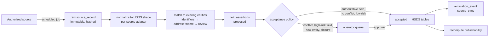
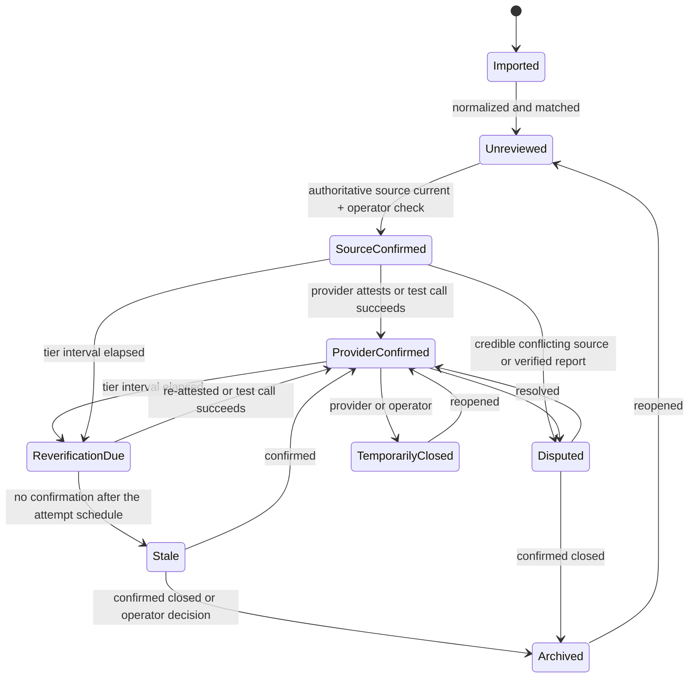
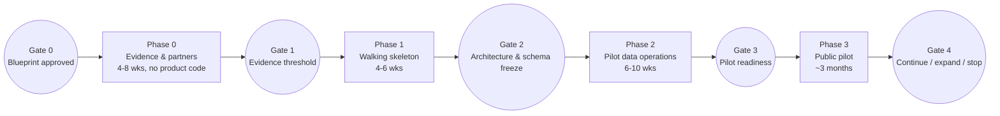

# ORAN 2.0: Strategic Foundation Blueprint

**Status:** Draft for founder approval (Gate 0). This is a planning document; nothing in it is implemented.
**Date:** 2026-11-02
**Evidence base:** [ORAN Comprehensive Platform Audit (2026-11-02)](../audit/ORAN_COMPREHENSIVE_PLATFORM_AUDIT_2026-11-02.md) and its [findings register](../audit/ORAN_AUDIT_FINDINGS_REGISTER_2026-11-02.md). The audit is treated as evidence, not as a specification. §17 lists where this blueprint departs from the audit's recommendations, and why.
**Scope rules for this document:** It contains no code, no schemas or DDL, no migrations, and no new repository. Entity descriptions in §6 are conceptual. They become schemas only after Gate 2.

## How to use this document

- **Founder:** read §1, §16, §18, and §19, then approve, amend, or reject each decision in §19.
- **AI agents:** §15 (the Constitution) is binding. Everything else explains it. If a task conflicts with §15, stop and raise it, citing the rule ID (C1–C23). Do not resolve the conflict yourself.

---

## Table of contents

1. Product charter and long-term mission
2. Target audiences and stakeholder workflows
3. Competitive differentiation and institutional partnership strategy
4. Regional pilot assumptions and validation requirements
5. Resource acquisition and reverification architecture
6. Canonical data model and HSDS interoperability
7. Minimal security and privacy architecture
8. Product capability map (MVP, later, excluded)
9. Existing repository components to preserve or port
10. Technology stack and rationale
11. Modular software architecture and repository organization
12. UI/UX design-system principles
13. Testing, quality gates, CI/CD, and production operations
14. Development roadmap with approval gates
15. The ORAN 2.0 Constitution (binding rules for all agents)
16. Risks
17. Departures from the audit
18. Unresolved decisions and evidence requirements
19. Prioritized founder decisions required before Phase 1

---

## 1. Product charter and long-term mission

### 1.1 Problem statement (evidence-backed)

People who need help with food, shelter, health care, legal problems, or a crisis lose time and trust to directory listings that are stale or wrong. The core failure is not a lack of directories. Washington alone has WA211 (~17,000 services), the state Community Information Exchange (CIE, in development), federal locators, and county lists. The failure is that **nobody can tell, at the moment of need, whether a listing is still true**.

The audit's own evidence shows that the hard part is keeping information correct, not building software. Infrastructure for this kind of product costs roughly $90–150 a month. Verification labor costs about 0.4–0.5 FTE per ~1,500 listings (audit §17).

### 1.2 Mission

> **ORAN makes local help findable and trustworthy, by showing people what is available, who it is for, how to get it, and how recently someone confirmed it is true.**

### 1.3 Charter commitments

| Commitment | Meaning in practice |
| --- | --- |
| Truth over coverage | ORAN publishes fewer listings it can stand behind rather than more it cannot. Every listing shows when, how, and by whom it was last confirmed. |
| Accuracy is measured and published | Accuracy is a number ORAN measures monthly with test calls and makes public. It is not an adjective. |
| Complement, don't compete | ORAN strengthens 211 and community data systems. It credits sources, feeds corrections back, and never scrapes against terms. |
| Safety and dignity | No account is required to find help. ORAN does not store anyone's circumstances on its servers. A quick exit is always available. Crisis help is visible on every screen. |
| Plain and fast | Pages work on a low-end phone over a slow connection, are written in plain language, and meet WCAG 2.2 AA. |
| Honest operation | ORAN never shows a feature, badge, or status that is not real. When the system is down, it says so. |

### 1.4 What ORAN is not

ORAN is not:

- a closed-loop referral or case-management system;
- an eligibility determination engine;
- a national directory, until it has earned one region;
- an AI chatbot;
- a replacement for 211's phone and text service.

### 1.5 Long-term vision (10 years, explicitly unvalidated)

The long-term vision is to be the **open accuracy layer** for human-services information in the United States. That means:

- a network of regional data partnerships;
- provider confirmations that flow back into the systems of record;
- published, comparable accuracy metrics;
- a public, accessible discovery experience;
- open HSDS feeds that any navigator tool can use.

Each step outward is earned by meeting the evidence gates in §14.

---

## 2. Target audiences and stakeholder workflows

### 2.1 Audiences (in priority order for the pilot)

| # | Audience | Who | What they need | Why this priority |
| --- | --- | --- | --- | --- |
| A1 | **Navigators** | Library staff, community health workers, FQHC front desks, coordinated-entry and shelter intake staff, school social workers, 211 specialists | Fast, accurate answers for someone in front of them; confidence that a phone number works; printable/shareable results | They search every day, notice errors instantly, and give feedback. They are the best early adopters and the strongest evidence of value. **Recommended primary pilot user.** (Founder decision D5) |
| A2 | **Self-navigating seekers** | Adults on phones, often with limited data, time, or digital literacy | Find one or two options nearby that they can actually use today | The ultimate beneficiary; hardest to reach directly in a pilot |
| A3 | **Proxy seekers** | Family members, friends, case managers searching for someone else | The same as A2, without exposing the other person's details | Common pattern; shapes privacy design |
| A4 | **Providers** | Program staff at nonprofits, clinics, agencies | A quick, trustworthy way to confirm or correct their listing without creating another account | They are the source of truth for availability |
| A5 | **Data partners** | 211 resource curators, county data teams, CIE operators | Error reports, provider confirmations, clean HSDS data back; attribution | Partnership is ORAN's data strategy (§3) |
| A6 | **ORAN operators** | Founder plus 1–3 reviewers/verifiers | One prioritized queue; fast verification logging; safe correction tools | Operations is the real product cost |
| A7 | **Funders and institutions** | Foundations, United Ways, counties, the Health Care Authority | Evidence of accuracy, reach, and outcomes | Sustainability |

**Safety-sensitive seekers** include domestic-violence survivors, undocumented people, and people in a mental-health crisis. They are not a separate audience; they are a design constraint that applies to every seeker surface.

### 2.2 Core workflows (MVP scope marked ◆)

**W1: Seeker finds help ◆**

1. The seeker chooses a need (one of 8–12 plain-language needs) or types a few words.
2. They give a location: a ZIP code or city, or the device location, which is coarsened on the device.
3. They see a list ordered by distance, limited to services whose service area covers that location. Each card shows a verification state and its date.
4. They open a listing and see:
   - what the service is;
   - who it is for (published criteria);
   - how to get help (intake method);
   - hours, if known;
   - contact details, and directions (handed off to the device's maps app);
   - "Confirmed by provider, 34 days ago".
5. They call, visit, or share the listing.

Crisis help is visible throughout, and quick exit is always available.

**W2: Seeker or navigator reports a problem ◆**

1. On a listing, they choose "Something's wrong".
2. They pick a reason: phone doesn't work, closed, wrong hours, not as described, other.
3. They can add an optional note. A bot check runs, and they submit.
4. The report creates a review task. It **never auto-hides the listing**, except as described in §5.6.

**W3: Provider confirms or corrects a listing ◆**

1. The provider receives an email (SMS later) with a single-use, expiring link scoped to one listing.
2. They see the current data with every field visible.
3. They choose "All correct", or edit fields and submit.
4. "All correct" creates a provider-attestation verification event. Edits go to operator review.
5. No account is required.

**W4: Operator works the queue ◆**

The queue has one list, prioritized by risk tier, overdue reverification, open reports, source changes, and pending provider edits. For each item the operator can:

- accept or reject proposed changes;
- log a test-call outcome;
- mark a service temporarily closed or closed;
- merge duplicates;
- request a provider attestation.

Every action is audited.

**W5: Scheduled source sync ◆**

1. A scheduled job pulls each authorized source and stores raw records unchanged.
2. It normalizes them into proposed field assertions and diffs them against accepted values.
3. Non-conflicting changes from authoritative sources are accepted automatically **only for the low-risk fields that the source agreement allows**. Everything else goes to the operator queue.

**W6: Data partner receives feedback ◆ (as an export)**

On a schedule, ORAN exports:

- confirmed corrections;
- closures;
- provider-confirmed data;
- unresolved reports,

for the partner's own curators. The format is HSDS bulk (JSON/CSV) plus a simple corrections report.

**W7: Navigator shares results (later)**

A print view, a share link, and a session-only shortlist. Nothing is stored on the server.

---

## 3. Competitive differentiation and institutional partnership strategy

### 3.1 The landscape (from audit §18, verified 2026-11-02)

| Actor | Role relative to ORAN |
| --- | --- |
| 211 / United Way National Data Platform / Connect 211 | **Primary partner.** They own curated regional data. ORAN cannot out-curate them. |
| Findhelp, Unite Us | Closed referral networks sold to health systems, health plans, and states. Do not compete on closed-loop referral; do not use their data. |
| WA Health Care Authority CIE (Comagine Health lead, 2027 launch) | **The state-level institution ORAN must align with**, or it will be made redundant. |
| USA.gov benefit finder, mRelief, PolicyEngine | Eligibility screeners. PolicyEngine is a possible later rules source. |
| County and nonprofit lists, spreadsheets, PDFs | Fragmented, often the most current local knowledge. They are sources, not competitors. |

### 3.2 Differentiation hypotheses, tested

| Hypothesis | Verdict | What would make it true |
| --- | --- | --- |
| Better design / mobile UX | **Not a moat.** Others ship mobile web. | Necessary but not sufficient |
| AI recommendations | **Rejected.** It creates risk in a safety context and is not defensible. | — |
| **Measured, published accuracy** | **Primary differentiator, if operated** | Monthly test-call sampling; accuracy shown per category and county |
| **Provider confirmation loop** | **Primary differentiator** | Attestation response rate validated in Phase 0 (§4.3) |
| **Corrections returned to the system of record** | **Partnership wedge** | A partner agrees to receive corrections; the format is agreed |
| Open HSDS data | Supporting | Licences permit redistribution |
| Privacy-protective, account-free seeker experience | Supporting, and important for safety-sensitive users | Architecture in §7 |
| Cross-source deduplication | Later | Needs at least two overlapping sources |

**Positioning statement (draft):**

> "ORAN is the accuracy layer for community resources. We help 211s and their communities keep listings true by confirming them directly with providers, measuring accuracy publicly, and returning every correction to the source, while giving people a fast, private, plain-language way to find help."

### 3.3 Partnership strategy

| Partner | Offer from ORAN | Ask of partner | Evidence needed before building partner features |
| --- | --- | --- | --- |
| WA211 (first approach) | Free provider-attestation outreach and stale-record detection for the pilot county; a corrections feed back to WA211; attribution on every listing; an accessible public front end | Authorized data access (an NDP API request form naming ORAN, or a periodic HSDS export) under a written data-sharing agreement (DSA) that covers display, redistribution, derivatives, attribution, and withdrawal | Written interest (a letter of intent or email) and the DSA terms |
| WA HCA CIE program | An HSDS-conformant directory contributor and verification service | A participation path; standards alignment | Attendance at public sessions; named contact |
| Navigator organizations (libraries, FQHCs, coordinated-entry lead, school districts) | A tool their staff can use; accuracy reporting for their area | Pilot users; feedback; reporting errors | 3+ organizations commit to a pilot |
| County human services | Verification-as-a-service for county-funded programs | A small contract or grant | One conversation showing willingness to pay or fund |
| Foundations, United Way local chapters | A public-good accuracy infrastructure | Grant funding for verification labor | An aligned funding call or program officer interest |

**Fallback plans if WA211 declines or cannot engage** (its funding was cut 66% for 2025–27):

- **Plan B:** a county-scoped directory built from authoritative federal sources, county and nonprofit lists that ORAN is authorized to use, and ORAN's own verification. This means a smaller scope, possibly 2–3 categories.
- **Plan C:** partner with one navigator network, for example a library system, to co-curate the listings their staff already rely on.

### 3.4 Business model (hypotheses to validate, not assumptions)

| Revenue or funding path | Fit | Validation needed |
| --- | --- | --- |
| Grants and philanthropy (civic tech, United Way, health foundations) | Highest near-term fit | Identify 3 open funding opportunities |
| County or state contracts for verification services | Medium | One willing buyer conversation |
| Subcontracting to a CIE vendor | Medium, from 2027 | CIE vendor procurement timeline |
| Health plan / health system SDOH directory licensing | Weakened by CMS reporting changes; competitive | Defer |

**Entity form matters** (Founder decision D3). Nonprofit or fiscal-sponsor status affects 211 trust, the 211 National Data Platform's 5% revenue fee, the price tier of the 211 taxonomy licence (211HSIS), and grant eligibility.

---

## 4. Regional pilot assumptions and validation requirements

### 4.1 Pilot assumptions (each must be validated or replaced)

| ID | Assumption | Why it is assumed | How it is validated (Phase 0) | Kill or adjust criterion |
| --- | --- | --- | --- | --- |
| PA1 | The pilot is in **Washington State, one county** | Existing HRSA WA data; WA211; the state CIE; founder context | Founder confirms (D1) | Founder chooses another region |
| PA2 | The pilot covers 4 need categories: food, housing/shelter, health (physical and behavioral), legal/crisis | Highest-frequency needs; mix of volatile and stable data | Navigator interviews rank needs | Re-rank by interview data |
| PA3 | Pilot size is ~400–1,500 services | Manageable by 0.5 FTE of verification | Baseline count from WA211 public search plus federal sources for the county | Above 2,000: narrow categories |
| PA4 | Providers will confirm listings via an emailed link | Industry practice; low friction | **Concierge test:** manually email 50 providers using a form; measure response within 14 days | Below 25% response: switch to phone-first verification and re-budget labor |
| PA5 | A verification averages ≤ 10 minutes per listing | Audit model (8 min) | Time 100 manual verifications | Above 15 minutes: re-budget or narrow scope |
| PA6 | A data partner will authorize access | 211 NDP model; WA211's stated interest in national data initiatives | Outreach; DSA draft | No partner within 8 weeks: Plan B |
| PA7 | Navigators will use a new tool if it is more accurate | Pain reported by navigators (to be confirmed) | 10–15 navigator interviews plus prototype usability tests | Fewer than 5 of 15 would switch: rethink the value proposition |
| PA8 | Seekers do not need accounts | Privacy; friction | Interviews and usability tests | Strong demand for cross-device saving: add a privacy-reviewed option later |
| PA9 | English and Spanish cover most of the pilot need | WA demographics (county-specific) | ACS language data for the chosen county | Add a third language if it reaches 5% of residents with limited English |

### 4.2 Pilot-county selection criteria (Founder decision D1)

Score each candidate county on:

1. A committed local partner (a navigator organization, United Way chapter, or county agency).
2. A manageable size (PA3).
3. Visible unmet need for better information, measured by navigator interviews and complaints.
4. Founder proximity, for in-person provider and partner work.
5. Low incumbent saturation: avoid a county where a new, well-run directory has just launched.

Example candidates to evaluate: Pierce, Spokane, Snohomish, Thurston, Whatcom, Yakima. King County is possible but crowded and large. This list is illustrative only. **The blueprint does not choose a county.**

### 4.3 Phase 0 evidence package (no code required)

| Evidence | Method | Output |
| --- | --- | --- |
| Need validation | 10–15 navigator interviews; 5–8 seeker interviews (with partner-organization consent and compensation) | Ranked needs, top failure modes, willingness to adopt |
| Data baseline | Count services per category for the county (WA211 public search, HRSA, SAMHSA, Head Start, HUD, WSDA food banks) | Target listing count; source coverage map |
| Source accuracy baseline | Test-call 100 randomly sampled listings from existing sources | Baseline accuracy %, which becomes ORAN's improvement target |
| Provider response | Concierge attestation to 50 providers | Response rate; edit rate; common corrections |
| Verification cost | Time 100 verifications | Minutes per listing per tier → staffing model |
| Partner interest | WA211, CIE, 3+ navigator organizations | LOI, email confirmations, or rejections |
| Legal review | Washington privacy counsel: My Health My Data Act (MHMDA) and consumer health data; DSA template review | Written guidance |

---

## 5. Resource acquisition and reverification architecture

### 5.1 Principles

1. **Nothing enters the catalog except through one acceptance path.** Every change becomes a field assertion, which is accepted or rejected. The HSDS tables hold accepted values only.
2. **Raw source data is immutable.** Every source record is stored as received, with a hash, retrieval time, and source.
3. **Sources are authorized, not discovered.** Every source has a registry entry and a recorded agreement or licence basis before its first import.
4. **Verification is an event, not a score.** ORAN records what was checked, how, by whom, and when. It does not compute opaque confidence numbers.
5. **Stale is visible, not silent.** Overdue listings show a warning, and are hidden only under explicit rules (§5.6).

### 5.2 Source registry

Each source entry records:

- **Identity:** name, owner, and contact.
- **Access:** access method (API, bulk file, manual list, provider attestation, operator entry).
- **Legal basis:** licence or agreement reference; permissions for display, redistribution, and derivatives; required attribution text; withdrawal procedure.
- **Field authority:** which fields this source is authoritative for (for example, HRSA is authoritative for site address and FQHC status, but not hours).
- **Sync:** sync schedule and an expected-change envelope (for example, "alert if more than 20% of records change").
- **Status:** active, paused, or withdrawn.

**Withdrawal is a kill switch.** Setting a source to withdrawn removes its exclusively sourced listings from public view on the next publish cycle (target: under 1 hour), and keeps them for audit.

### 5.3 Acquisition channels

| Channel | MVP? | Examples | Notes |
| --- | --- | --- | --- |
| Partner feed (API or bulk) | ◆ if a partner signs | WA211 via the NDP, or an HSDS export | Connector reuses lessons from the old 211 client (§9) |
| Federal authoritative files | ◆ | HRSA health centers, SAMHSA FindTreatment (via its API request form), Head Start locations, HUD housing counselors | Registry-backed; low volatility |
| State and county lists | ◆ where authorized | WSDA food banks, county program lists | Check terms per source |
| Provider attestation | ◆ | Emailed link (W3) | Highest-value verification |
| Operator entry | ◆ | Gap-filling; phone-verified listings | Labeled as ORAN-originated |
| Public reports | ◆ | W2 | Triggers review only |
| Provider self-service accounts | Later | — | Only after attestation shows engagement |
| Web extraction (crawl, LLM) | **Excluded from MVP** | — | High operating cost and legal risk; revisit only for operator assistance (§8) |

**Not sources:**

- USDA SNAP retailers. Use at most as an "accepts EBT" attribute.
- The IRS Business Master File. Use for organization identity only.
- NPPES (individual clinicians).
- Any site whose terms prohibit automated collection (for example, Findhelp).

### 5.4 Import pipeline (conceptual)



Rules for the import pipeline:

- **Idempotency.** Re-running an import with the same input changes nothing, using deterministic IDs and payload hashes (pattern ported from the old HRSA importer).
- **Drift guard.** If a sync exceeds its expected-change envelope, nothing is accepted automatically and the operator is alerted.
- **Matching.** Order of precedence:
  1. exact external identifier (an HSDS `organization_identifier`: EIN, HRSA ID, or a 211 record ID);
  2. normalized address plus fuzzy name, proposed as a match for review;
  3. never auto-merge on name alone.
- **Updates never hide listings.** An upstream update to a published listing is proposed as new assertions. The listing stays visible with its last accepted values until the change is reviewed or auto-accepted. This corrects a defect in the old system (audit ORAN-019).

### 5.5 Conflict resolution

There is a precedence order for each field family:

| Field family | Precedence (highest first) |
| --- | --- |
| Availability, intake status, hours | Provider attestation (≤ tier interval) → operator test call → partner feed → federal file |
| Location and address | Federal registry (for registry-backed sites) → partner feed → provider → operator |
| Eligibility text, description | Provider → partner feed → operator |
| Phone, URL | Operator test call → provider → partner feed |
| Existence / closure | Provider or operator confirmation → partner feed → 2+ independent reports (trigger review only) |

How conflicts are handled:

- When two sources disagree on a field and neither outranks the other within its freshness window, the system creates a review task.
- Seekers see the last accepted value, labeled "Being reviewed".
- Every accepted value records which assertion it came from, so provenance can be traced for each field.

### 5.6 Listing lifecycle (proposed state model)



"TemporarilyClosed" maps to HSDS `service.status = temporarily closed`. "Archived" maps to `inactive` or `defunct`, depending on the reason.

**Publishability rule (one rule, computed when the state changes, stored on the listing, never re-derived by complex queries):**

| State | Tier A (volatile/high-harm) | Tier B | Tier C (registry-backed) |
| --- | --- | --- | --- |
| Unreviewed / Imported | Hidden | Hidden | Visible with "Not yet reviewed" **only if** the source is authoritative and the agreement permits (Founder decision D13) |
| Source-Confirmed | Visible | Visible | Visible |
| Provider-Confirmed | Visible | Visible | Visible |
| Reverification Due | Visible + "Confirmation overdue" | Visible | Visible |
| Stale | **Hidden** | Visible + warning | Visible + warning |
| Disputed | Visible + "Being reviewed"; hidden if the dispute is a reported closure verified by an operator call | Same | Same |
| Temporarily Closed | Visible as closed, with reopening info if known | Same | Same |
| Archived | Hidden | Hidden | Hidden |

Two conditions always apply on top of the table:

- **Source withdrawal overrides everything.** Listings sourced only from a withdrawn source are hidden.
- **Reports never auto-hide.** Exception: 2+ independent reports of closure within 14 days on a Tier A listing move it to Disputed, and an operator call is due within 2 business days.

### 5.7 Reverification framework

| Tier | Categories (pilot) | Interval | Attempt schedule | Methods |
| --- | --- | --- | --- | --- |
| A | Emergency shelter, DV services, food distribution schedules, rent and utility assistance | 30–45 days | Email on day 0 → reminder on day 5 → test call on day 10 → Stale on day 21 | Provider attestation, test call |
| B | Clinics, behavioral health, legal aid, employment, childcare | 90 days | Email on day 0 → reminder on day 10 → test call on day 20 → Stale on day 45 | Attestation, test call |
| C | FQHC sites (HRSA), public housing agencies, Head Start sites, national hotlines | Source sync monthly; human check yearly | Sync diff → operator review on change | Source sync, yearly test call |

**Accuracy measurement:**

- Each month, test-call a random sample of about 50 listings per tier.
- Record a pass or fail for each field checked: phone reaches the service, address, hours, intake method, and an eligibility summary.
- Publish the accuracy rate per tier on the public trust page.

This is ORAN's north-star quality metric.

---

## 6. Canonical data model and HSDS interoperability

### 6.1 Decision: HSDS-native core plus a minimal ORAN extension

| Option | Pros | Cons | Verdict |
| --- | --- | --- | --- |
| **A. HSDS 3.x-native tables plus a small provenance and verification extension** | Export is nearly direct; agents have a public spec to follow; interoperability by construction | HSDS has more tables than the MVP needs; some fields are unused | **Recommended.** Implement only the HSDS objects the MVP needs, using HSDS names and field semantics exactly. |
| B. A custom ORAN model with an HSDS export mapper | Freedom to optimize | The mapper becomes a second model, which is the drift that hurt ORAN 1.0 | Rejected |
| C. Store HSDS JSON documents (JSONB) per service | Simple ingestion | Weak constraints; hard geospatial and relational queries; drift inside JSON | Rejected for the core; acceptable for immutable raw source records |

**Version.** Pin HSDS to the 3.3.x line (latest release 3.3.1, 2026-09-09). Before Gate 2, an agent must confirm field names against the tagged schema files. Public docs pages may lag; one documentation page observed on 2026-11-02 still rendered the 3.0.1 reference.

### 6.2 HSDS core objects used in the MVP

- `organization`
- `organization_identifier`
- `service`
- `location`
- `service_at_location`
- `address`
- `phone`
- `schedule`
- `service_area`
- `language`
- `accessibility`
- `required_document`
- `contact` (organization-level and role-based only; no personal data)
- `url`
- `attribute`
- `taxonomy` and `taxonomy_term` (ORAN's own category vocabulary)
- `metadata` (HSDS change-history export)

Notes on how these are used:

- `service.status` uses the HSDS values: active, inactive, defunct, temporarily closed.
- `service.assured_date` is populated from the latest provider or test-call verification. `assurer_email` is left empty, to protect staff privacy.
- `schedule` uses the HSDS RRULE-style fields (`freq`, `byday`, `opens_at`, `closes_at`, `valid_from`, `valid_to`, `timezone`, ...).
- `service_area` uses `extent` and `extent_type` for polygons or named areas.

**Deferred HSDS objects:** `program`, `funding`, `cost_option`, `service_capacity`, `unit`. Add them when a validated workflow needs them. `service_capacity` is the likely first, for shelter beds.

### 6.3 ORAN extension entities (conceptual; no schema until Gate 2)

| Entity | Purpose | Key attributes (conceptual) |
| --- | --- | --- |
| `source` | Registry entry (§5.2) | owner, access method, agreement reference, permissions (display, redistribute, derive), attribution text, field authority, status |
| `source_record` | Immutable raw payload | source, external ID, payload, hash, retrieved_at |
| `field_assertion` | A proposed value for one field of one HSDS entity | entity type and ID, field path, value, origin (source_record, attestation, operator, report), observed_at, status (proposed, accepted, superseded, rejected), decided_by, decided_at |
| `verification_event` | What was checked, how, and the outcome | service ID, method (source_sync, provider_attestation, test_call, operator_review), scope (fields covered), outcome, actor, observed_at, expires_at |
| `listing_state` | Lifecycle and publishability per service | state, tier, entered_at, next_review_due, is_publishable, reason |
| `attestation_request` | A provider link | service ID, recipient channel, token hash, expires_at, status |
| `public_report` | A seeker or navigator report | service ID, reason, optional note, created_at, triage status. **No IP address or identifier stored**; abuse is controlled at the edge (§7). |
| `work_item` | Operator queue entry | type, priority, subject, due_at, assignee, status |
| `job_run` | Scheduled job ledger | job, started/finished, counts, outcome, error |
| `audit_event` | Every privileged action | actor, action, subject, before/after reference, at |
| `membership` | Operator and provider authorization | user, role, organization scope |

**The single-write-path rule.** HSDS tables are written **only** by the acceptance service, which applies accepted `field_assertion`s and recomputes `listing_state` in the same transaction. No route, job, or script writes HSDS tables directly. This is the most important anti-drift rule in the data model. It replaces ORAN 1.0's three parallel models and its three-way publication query.

### 6.4 Geography

- Locations are points with a spatial index.
- Service areas are polygons, or named areas (county, city, ZIP, state, national) resolved to polygons from a bundled boundary set (Census TIGER).
- Matching asks whether the service area covers the seeker's location (point-in-polygon on coarsened coordinates), then sorts by distance where a physical location exists.
- National and virtual services (hotlines, telehealth) match by coverage, not distance. ORAN 1.0 could not do this (audit ORAN-016).

### 6.5 Taxonomy

- ORAN maintains its own small, plain-language category vocabulary: 8–12 seeker needs, each with sub-categories. It is published as an HSDS `taxonomy`.
- 211HSIS codes that arrive on partner records are stored as attributes, as received. They are **not redistributed** unless a 211HSIS licence permits it.
- The crosswalk from 211 codes to ORAN categories is internal (Founder decision D12, open-data stance).

### 6.6 Interoperability outputs

| Output | Phase | Validation |
| --- | --- | --- |
| HSDS bulk export (JSON + CSV data package), filtered by each source's redistribution permission | MVP | Validated in CI against the pinned HSDS schemas, plus the Open Referral UK validator where profile-compatible |
| Corrections feed to the data partner (HSDS records + change reasons) | MVP | Partner-agreed format |
| HSDS read API (`/services`, `/organizations`, ...) | Later | Same validators |

---

## 7. Minimal security and privacy architecture

### 7.1 Data minimization (the primary control)

| Data | Collected? | Notes |
| --- | --- | --- |
| Seeker identity | **No.** No seeker accounts in the MVP | Founder decision D8 |
| Seeker circumstances (DV, immigration, health, income, age) | **No**, never sent to or stored on the server | Filters use listing attributes; the seeker's choices stay in the URL or session on the device |
| Seeker location | Coarsened on the device (~1 km), or ZIP/city resolved from a bundled gazetteer | Never logged; never sent to third parties (no third-party geocoding of seeker input) |
| Search terms | Not logged with identifiers. Aggregate counters only (category, county, zero-result flag) | Free text is not retained (MHMDA risk) |
| Public reports | Reason plus optional note; no IP and no identifiers | Notes are warned "do not include personal information" and redacted by the operator if needed |
| Operator and provider accounts | Clerk identity; DB membership | Least privilege |
| Provider contact data | Organization or role contacts used for attestation | Stored only as needed; covered by the DSA and privacy policy |

The **regulatory posture** follows from this minimization. ORAN aims to stay outside "consumer health data" collection under Washington's MHMDA by not collecting it. Washington privacy counsel must confirm this during Phase 0 (evidence item). HIPAA does not apply: ORAN is not a covered entity or business associate. Re-check this if a health-system contract appears.

### 7.2 Authentication and authorization

- **Identity:** Clerk, for operators and provider accounts (later). Provider attestation uses signed, single-use, expiring links scoped to one listing (HMAC token stored only as a hash; 14-day expiry; rate-limited).
- **Roles (minimal):**
  - `admin`: configuration, sources, users.
  - `reviewer`: queue, verification, edits.
  - `provider_editor`: one organization's listings, later.
- **Enforcement:**
  - A single `authorize(actor, action, resource)` policy module, deny by default.
  - Every route declares its policy.
  - A CI test fails if any route lacks a policy declaration.
  - Organization scoping is checked against memberships, never against a global profile role (audit ORAN-045).
- **Two-person rule:** required for source registration and withdrawal, bulk operations, and role grants. Single-reviewer approval is allowed for routine listing edits, with an audit trail.

### 7.3 Database security

- The app uses a least-privilege runtime role. A separate migration role is used only by CI and deploy. Importers use a role that may write only to `source_record` and `field_assertion`.
- Row-level security (RLS) is enabled on all tables as a deny-all backstop for browser roles. Supabase Data API exposure is disabled or limited to an empty schema (pattern ported from ORAN 1.0 migrations 0066/0075).
- Secrets live only in Vercel and GitHub environment secrets. Nothing secret uses the `NEXT_PUBLIC_` prefix. An environment contract validates configuration at boot.

### 7.4 Application security

- **Input:** schema-validated at every boundary.
- **SQL:** parameterized queries only. A lint rule bans string-built SQL.
- **Outbound fetch:** importers only, through an SSRF-safe client (ported from ORAN 1.0).
- **Headers:** nonce-based Content Security Policy (no `unsafe-inline` scripts); HSTS; frame-ancestors none.
- **Rate limiting:** at the edge (Vercel Firewall rules, if the plan supports them), otherwise Postgres-backed.
  - **Public reads fail open** if the limiter backend is unavailable, so availability for people in need wins.
  - **Writes fail closed.**
  - An outage must never be shown as "rate limited" (audit ORAN-002).
- **Abuse on public reports:** a bot challenge (Cloudflare Turnstile) plus edge rate limits. Reports never auto-suppress (§5.6).
- **Telemetry:** Sentry with URL and query scrubbing on events, breadcrumbs, and transactions. No session replay. No third-party trackers or advertising pixels.
- **Dependencies:** automated updates. Critical or high advisories in production dependencies must be patched within 7 days, or have a documented exception.

### 7.5 Seeker safety features (MVP)

- A quick-exit control on every seeker page. It replaces the page and history entry with a neutral site.
- Neutral page titles. Sensitive categories such as DV are not put in the `<title>` or in shareable URLs by default.
- Crisis access on every page: 988, 911, the DV hotline, and 211, with the local 211 included. It is static and needs no classifier.
- No server-side history of a seeker's activity.

### 7.6 Retention

| Data | Retention |
| --- | --- |
| Raw source records | Retained for provenance while the source agreement permits; purged on withdrawal if the agreement requires |
| Public report notes | 12 months, then deleted. The report outcome is kept without the note. |
| Audit events | 3 years |
| Application logs | 30 days, scrubbed |

A scheduled job enforces retention, and its runs are monitored.

---

## 8. Product capability map

### 8.1 MVP (pilot launch)

| Area | Capabilities |
| --- | --- |
| Seeker | Need picker + keyword search; ZIP/city/device location; service-area-aware results ordered by distance; filters (category, language offered, accessibility, "verified within 90 days"); listing detail with verification state and date; call, visit, and directions handoff; share and print; report a problem; quick exit; persistent crisis strip; EN + ES interface |
| Provider | Attestation link: confirm, or propose edits |
| Operator | Prioritized work queue; record view with field-level provenance; accept/reject assertions; log test calls; set temporary closure or closure; merge duplicates with provenance; request attestation; source registry and job-run dashboard; report triage; audit log |
| Data | Importers for the pilot's authorized sources; acceptance service; lifecycle and publishability; reverification scheduler; retention job |
| Interop | HSDS bulk export; partner corrections feed |
| Trust | Public trust page: sources and attribution, verification method, monthly accuracy rate, status driven by real health checks |
| Platform | Health checks, uptime monitoring, error monitoring, cron monitors, backups with a tested restore |

### 8.2 Later phases (each needs an evidence trigger)

| Capability | Evidence trigger |
| --- | --- |
| Map view (MapLibre + privacy-preserving tiles) | Usability tests show navigators or seekers need spatial browsing |
| "Open now" filter | At least 70% of listings in a category have structured schedules |
| Provider self-service accounts | Attestation response rate of at least 40% and providers asking for direct editing |
| SMS attestation | Email response rate below target; SMS test shows lift |
| Public HSDS API | A named consumer requests it |
| Session or device shortlist; cross-device save | Interview demand; privacy review |
| Benefits eligibility guidance (PolicyEngine) | Navigators identify benefits screening as a top need; licence review |
| Translated listing content | Language data plus a partner translation capacity |
| Partner dashboards and accuracy reporting | Partner requests it |
| Embeddable widget for CBO websites | 3+ organizations request it |
| Second county or region | Gate 4 |
| AI-assisted operator tools (diff summaries, extraction drafts, always human-reviewed) | Operator time data shows a bottleneck AI could cut by at least 30% |
| Guided conversational search | Strong evidence that guided search outperforms the need picker; expert-built crisis test set |

### 8.3 Excluded (not on the roadmap without a charter change)

- Closed-loop referrals, consent management, case management.
- Seeker profiles that store circumstances (DV, immigration, health, income).
- AI-generated answers or recommendations to seekers; opaque scores and "match" percentages.
- Automated "you qualify" determinations.
- Scraping sources whose terms prohibit it; using closed-network data (Findhelp, Unite Us).
- Native mobile apps (the web app must work well on phones).
- National coverage claims; multi-region governance machinery before a second region exists.
- Payments, advertising, data sales.

---

## 9. Existing repository components to preserve or port

**Port rules:**

- "Port" means **re-implement from the reference, with tests, inside the new architecture**. It does not mean copying files wholesale. Each port is a small PR that cites the source path and commit `e0c9afd`.
- The ORAN 1.0 repository stays intact and read-only as a reference.

| Component | Source (ORAN 1.0 @ `e0c9afd`) | What to keep | What to change |
| --- | --- | --- | --- |
| Idempotent, provenance-preserving import | `scripts/import/hrsa-wa-release.ts`, `src/services/ingestion/hrsaWa.ts` | Deterministic IDs, payload hashing, drift guards, withdrawn-site handling | Emit `field_assertion`s instead of writing live tables; run as a scheduled job |
| HRSA WA dataset handling | same | Field mapping, licence note | Monthly scheduled sync |
| SSRF-safe outbound HTTP | `src/services/security/outboundHttpPolicy.ts` | Per-hop redirect validation, private-range blocking, DNS pinning | Updated `undici`; importer-only use |
| DB role model and RLS backstop | migrations 0066, 0074, 0075; `runtimeRole.ts` | Least-privilege runtime role, fixed-role check, deny-all RLS, isolated Data API schema | Simpler grant set for the smaller schema; separate importer role |
| Environment contract and provider guard | `src/services/runtime/envContract*`, `providerPolicy.ts` | Boot-time env validation | Remove Azure-specific logic; keep a minimal contract |
| Migration verification harness | `scripts/db/verify-migrations.mjs`, `disposable-postgres.sh` | Fresh-DB apply in CI; single-statement rule for `CONCURRENTLY` | Integrate with the chosen migration tool |
| Seeker provenance display | `src/services/provenance/publicProvenance.ts` | Evidence-only provenance language | Driven by `verification_event` and `listing_state` |
| Crisis resource content | `crisisData.ts`, `src/domain/constants.ts` (hotline list) | Verified hotline numbers and copy | Static crisis strip; **do not port the classifier** for the MVP |
| 211 connector knowledge | `src/agents/ingestion/ndp211Connector.ts`, `docs/_archive/2026-03/working-notes/211_info_001.md` | Base URL, auth header, payload types | Drop the `dataOwners` header; use the correct V2 discovery; contract tests from Trial definitions |
| Security headers baseline | `next.config.mjs` | HSTS, frame, referrer, permissions policy | Nonce CSP |
| Account-erasure design thinking | ADR-0014 | Fail-closed, auditable erasure | Much smaller scope: operator and provider accounts only |
| Seeker copy patterns | `src/components/seeker/*` | "Who may qualify", "Eligibility not guaranteed" | Rewritten against the design system's content standards |
| Hotline set | migration 0065 data | The 13 verified national hotlines | A versioned seed entering through the normal acceptance path (rebuildable; audit ORAN-039) |

**Do not port:**

- The LLM ingestion and candidate pipeline.
- The scorer and its weights.
- The canonical/candidate parallel layers.
- Drizzle and the dual connection pools.
- The feature-flag catalog.
- The agent control plane.
- Zone and scope management.
- In-memory rate limiters.
- The four-portal UI structure.
- Governance and scenario documentation.
- The 290k legacy rows.

---

## 10. Technology stack and rationale

The current operating contract (`AGENTS.md`) locks the provider direction to Vercel + Supabase + Clerk for the founder's portfolio. This blueprint **recommends keeping that lock**, and shows the alternatives so the decision is explicit (Founder decision D6).

| Layer | Recommendation | Alternatives considered | Rationale |
| --- | --- | --- | --- |
| Language | **TypeScript everywhere** (app, importers, jobs) | Python for data jobs | One language, shared types, easiest for AI agents; the data volume is small |
| Web framework | **Next.js (App Router), constrained subset**: server components for reads, route handlers for writes, no experimental features | React Router 7/Remix; Astro; SvelteKit | Portfolio consistency and agent familiarity. The risk is a high-severity CVE cadence (audit ORAN-004), mitigated by the 7-day patch rule and avoiding rarely needed surfaces (`next/image` optimizer, `use cache`, next/og). Astro would suit a mostly-static seeker site, but it splits the ops console into a second framework. |
| Hosting | **Vercel** (Pro) | Fly.io, Render, Cloudflare | Locked; simple; preview deploys |
| Database | **Supabase Postgres + PostGIS, used as plain Postgres** | Neon, RDS, self-hosted | Locked. Avoid Supabase-specific runtime features (Data API, Edge Functions, Storage) unless a validated need appears, to keep portability. Use the **Pro plan**, so the project is never paused for inactivity. |
| Migrations | **Plain, ordered SQL migrations via the Supabase CLI**; local stack via `supabase start` | Drizzle-kit, Prisma Migrate, node-pg-migrate | SQL is the contract, and PostGIS is first-class. The same tool works locally, in CI, and in production. Trade-off: Docker is needed locally. |
| DB access | **Kysely query builder with types generated from the live schema** | Drizzle; Prisma; raw `pg` | Types derive from the database, so hand-maintained schema drift cannot happen (ORAN 1.0 had it). Composable SQL with good PostGIS escape hatches. One pool. |
| Search | **Postgres full-text search + PostGIS** | Meilisearch, Typesense, Elasticsearch | Pilot scale is under 5k listings. One datastore. Revisit above about 100k listings, with measurements. |
| Auth | **Clerk** for operators and providers; **no seeker accounts** | Supabase Auth; Auth.js | Locked; already integrated. Seekers stay anonymous by design. |
| Background jobs | **GitHub Actions scheduled workflows invoking job entry points** (`jobs/*`) against the database; Sentry cron monitors | Vercel Cron; Inngest/Trigger.dev; pg_cron | No serverless timeouts for imports; logs and secrets in one place; no new vendor. Trade-off: Actions schedules can be delayed by minutes, which is acceptable for daily or hourly jobs. **One scheduler only.** |
| Email | **Resend** (attestation and operator notifications) | Postmark, SES | Already in use; simple |
| SMS | Deferred | Twilio | Evidence trigger (§8.2) |
| Import geocoding | **US Census Geocoder (batch)**, with operator correction | Nominatim, Mapbox, Google | Free and US-authoritative. Avoids the Nominatim bulk-use policy and Mapbox storage terms. |
| Seeker location | **Bundled gazetteer** (ZIP and place centroids, county polygons from Census) + coarsened device location | Third-party geocoder | Seeker input never leaves ORAN; no cost; works offline-ish |
| Maps (later) | **MapLibre GL + self-hosted Protomaps PMTiles**, or a paid tile provider | OSM public tiles; Mapbox | No tile requests leak seeker location to third parties; no OSM tile-policy risk |
| UI | **Tailwind CSS + Radix primitives wrapped as owned components**; lucide icons | Component libraries (MUI, Chakra); shadcn as-is | Small, accessible primitives; tokens enforced; no runtime CSS-in-JS |
| i18n | Message catalogs from day one (e.g., `next-intl`) | Ad hoc strings | Spanish at launch; no hardcoded seeker strings |
| Testing | Vitest (unit); Vitest against real Postgres+PostGIS (integration); Playwright + axe (e2e/a11y) | Jest; Cypress | Real-database testing is mandatory (audit ORAN-029) |
| Monitoring | **Sentry** (errors, cron monitors) + **one external uptime monitor** + health-driven status page | Datadog; Better Stack all-in-one | Minimal; the founder gets phone alerts |
| Analytics | **Aggregate server-side counters in Postgres** (no third-party analytics in the MVP) | Plausible; Vercel Analytics; PostHog | Privacy; MHMDA; enough for pilot questions |
| Package manager | **pnpm** (matches the control plane) | npm | Consistency with `AGENTS.md` tooling (ORAN 1.0 actually used npm) |

**Estimated monthly software cost (list prices, not verified charges):** Vercel Pro $20, Supabase Pro $25+, Sentry Team $26, uptime monitor $0–20, Resend $0–20, Clerk $0. Total: about **$75–$115 per month**.

---

## 11. Modular software architecture and repository organization

### 11.1 Repository decision (Founder decision D7)

| Option | Pros | Cons | Verdict |
| --- | --- | --- | --- |
| **A. New repository** (e.g., `oran`; ORAN 1.0 renamed or archived as `oran-v1-reference` after the pilot) | Clean history; no accidental cross-imports; agents are not confused by 1.0 patterns; clear contract file | Two repos during the transition | **Recommended** |
| B. A `v2/` directory inside the current repository | One place | Agents will read and reuse 1.0 code and docs (the 189 doc files are a drift magnet); CI and lint collisions; the existing auto-deploy to production on merge | Rejected |
| C. Orphan branch in the current repository | Shared remote | Confusing; still the same production deploy hook | Rejected |

### 11.2 Architecture style: a modular monolith with one deployable

- There is one Next.js application, plus job entry points that share its modules. There are no microservices, no message queue, and no separate API service.
- **Module boundaries are enforced by lint rules** (for example `eslint-plugin-boundaries` or dependency-cruiser). The rules are:
  - a module exposes a public `index.ts`;
  - no module imports another module's internals;
  - only `platform` and `ui` are shared by all modules.

### 11.3 Modules

| Module | Responsibility | Owns (conceptual entities) | Depends on |
| --- | --- | --- | --- |
| `platform` | DB client (single pool), config/env contract, logging and scrubbing, rate limiting, outbound HTTP policy, job runner, time and IDs | `job_run` | — |
| `identity` | Clerk adapter, memberships, `authorize()` policy | `membership` | platform |
| `catalog` | HSDS entities; read queries; **acceptance service (the single write path)**; publishability | HSDS tables, `listing_state` | platform |
| `sources` | Source registry, agreements, raw records | `source`, `source_record` | platform |
| `importers` | One adapter per source: fetch → raw → normalize → match → propose assertions | — (writes through `sources` and `verification`) | sources, verification, platform |
| `verification` | Field assertions, conflict rules, verification events, lifecycle transitions, reverification scheduling, attestation requests | `field_assertion`, `verification_event`, `attestation_request` | catalog, platform |
| `discovery` | Seeker search: filters, service-area matching, ordering, result explanations | — (reads catalog) | catalog, platform |
| `reports` | Public report intake and triage | `public_report` | verification, platform |
| `operations` | Work queue, operator actions, audit log | `work_item`, `audit_event` | verification, catalog, reports, identity |
| `interop` | HSDS export, partner corrections feed, validation | — | catalog, sources |
| `privacy` | Retention jobs, redaction utilities, erasure for accounts | — | platform |
| `ui` | Design system: tokens, primitives, patterns, layouts | — | — |

### 11.4 Repository layout (proposed)

```text
oran/
  AGENTS.md                  # points to docs/CONSTITUTION.md; tooling commands only
  docs/
    CONSTITUTION.md          # §15 of this blueprint, verbatim once approved
    CHARTER.md               # §1–§3
    ARCHITECTURE.md          # §10–§11
    DATA_MODEL.md            # §5–§6 (conceptual) + generated schema reference
    DESIGN_SYSTEM.md         # §12
    OPERATIONS.md            # §13 runbooks (≤5)
    adr/                     # numbered decision records
  src/
    app/
      (seeker)/              # public discovery pages
      (ops)/                 # operator console (Clerk-protected)
      (attest)/              # provider attestation flow (token-protected)
      api/                   # route handlers (each declares policy)
    modules/<module>/        # index.ts, domain/, data/, policy.ts, *.test.ts
    ui/                      # tokens/, primitives/, patterns/, layouts/
  jobs/                      # entry points: import-<source>, reverify, retention, export
  supabase/migrations/       # ordered SQL migrations
  tests/
    integration/             # real Postgres+PostGIS
    e2e/                     # Playwright + axe against preview
  .github/workflows/         # ci.yml, deploy.yml, jobs.yml
```

**Documentation budget:** at most about 10 core documents plus ADRs. New top-level documents require an ADR. There are no "scenario" or "audit" document sprawls inside the product repository.

---

## 12. UI/UX design-system principles

### 12.1 Experience principles

1. **One next step.** Every seeker screen answers one question and shows the obvious next action.
2. **Plain language.** Target a grade 6–8 reading level. Avoid agency jargon. Use verbs such as "Call", "Get directions", "What to bring".
3. **Truthful status.** Use the standard verification vocabulary (§12.4) and nothing else. No scores, stars, or "match %".
4. **Fast on bad networks.** Seeker pages are server-rendered and usable without client JavaScript for the core search and detail flow (progressive enhancement).
5. **Calm and safe.** Use neutral visuals, a quick exit, crisis access, and no alarming animation.
6. **Consistent.** Build screens only from approved layouts and components. Add a new component only through the design-system process.

### 12.2 Foundations (tokens)

- **Color:**
  - semantic tokens: surface, text, muted, accent, success, warning, danger, info;
  - every text/background pair meets WCAG AA (4.5:1 body, 3:1 large text);
  - status never relies on color alone.
- **Type:** a system font stack. Body text is at least 16px. The type scale has at most 6 steps. Line length is 45–75 characters.
- **Spacing:** a 4px-based scale with about 8 steps. Arbitrary values need design-system approval, enforced by lint.
- **Touch targets:** at least 44×44px. Visible focus rings on every interactive element.
- **Motion:** minimal. Respect `prefers-reduced-motion`.
- **Layout:** mobile-first from 360px, using logical CSS properties so the layout is RTL-ready. RTL is enabled only for a fully translated language.

### 12.3 Components and layouts (initial inventory, about 25)

- **Primitives:** Button, Link, TextField, SearchField, Select, Checkbox, RadioGroup, Dialog, Disclosure, Tabs, Badge, Banner, Spinner, Skeleton, VisuallyHidden.
- **Patterns:** ListingCard, VerificationBadge, ContactActions (call, directions, share), HoursTable, CrisisStrip, QuickExit, EmptyState, ErrorState, OutageState, ReportProblemForm, Pagination, FilterBar, OpsQueueRow, ProvenanceList, DiffView.
- **Layouts:** SeekerShell, SeekerSearchPage, ListingDetailPage, AttestationPage, OpsShell, OpsQueuePage, OpsRecordPage.

**Component catalog:** a development-only route that renders every component in every state, with Playwright visual and axe tests. Storybook is not used.

### 12.4 Standard trust vocabulary (exact copy, owned by the design system)

| State | Seeker label | Detail line |
| --- | --- | --- |
| Provider-Confirmed | "Confirmed by provider" | "{N} days ago" |
| Source-Confirmed (test call) | "Confirmed by ORAN" | "Phone check, {N} days ago" |
| Source-Confirmed (sync) | "From {Source}" | "Updated {date}" |
| Reverification Due | "Confirmation overdue" | "Last confirmed {N} days ago, call ahead" |
| Stale | "May be out of date" | "We couldn't confirm this recently, call ahead" |
| Disputed | "Being reviewed" | "Someone reported a problem; call ahead" |
| Temporarily Closed | "Temporarily closed" | reopening info if known |
| Unreviewed (Tier C only) | "Not yet reviewed" | "From {Source}" |

### 12.5 Required states for every screen

Every screen must design each of these states: loading, empty (no input), zero results (with recovery: widen the area, other categories, the local 211 number for the seeker's region), error, **outage** (honest message plus crisis numbers plus the 211 link), offline (cached shell plus crisis numbers), and success.

### 12.6 Performance and accessibility budgets

| Budget | Target |
| --- | --- |
| Seeker route first-load JavaScript | ≤ 90 KB gzip (ORAN 1.0 measured 3.4–4.5× over its own budget) |
| Largest Contentful Paint | ≤ 2.5 s on a mid-range Android over a throttled 4G profile |
| Accessibility | WCAG 2.2 AA. Axe shows zero serious or critical issues on every layout in CI. A manual screen-reader pass (VoiceOver and TalkBack) on seeker flows each release. |
| Language | All seeker strings come from message catalogs. Spanish is reviewed by a native speaker before launch. |

---

## 13. Testing, quality gates, CI/CD, and production operations

### 13.1 Test layers

| Layer | What | Rule |
| --- | --- | --- |
| Unit | Pure domain logic: lifecycle transitions, publishability, conflict precedence, policy decisions | Required for every domain rule |
| Integration (**real Postgres + PostGIS**, migrations applied from scratch) | Acceptance service, imports (idempotency, drift guard), service-area matching, authorization and organization scoping, retention | **Mandatory for any change touching data or authorization.** Mocking the database is forbidden in integration tests. |
| Contract | Each importer against recorded real payload fixtures (licence permitting) and the provider's published schema | Fails on schema change |
| E2E + a11y | Playwright + axe against the preview deployment with a seeded fixture database: search → detail → report; attestation; operator queue → accept | Runs on every PR |
| Export validation | HSDS export validated against the pinned schema | Runs on every PR touching catalog or interop |

### 13.2 Required PR checks (all blocking)

- typecheck
- lint, including module boundaries, the ban on string-built SQL, and design-token rules
- unit tests
- integration tests
- e2e and a11y tests
- bundle budget
- dependency audit: critical or high blocks, unless an exception is documented with an expiry
- migration safety: fresh apply, plus an expand/contract check
- route-policy coverage
- HSDS validation

### 13.3 Definition of Done (applies to every change, human or agent)

1. It works **end-to-end against a real database** in the preview environment.
2. Tests at the right layer were added, and they would fail without the change.
3. There are no new environment variables, tables, routes, or dependencies without the matching contract or ADR entry.
4. User-facing copy uses the design system and trust vocabulary, and is present in EN and ES catalogs.
5. Observability is in place: errors reach Sentry, and jobs have cron monitors.
6. Docs are updated only where behavior changed. No new documents without an ADR.
7. The PR is ≤ ~400 changed lines excluding tests and fixtures, or split.

### 13.4 Environments and deployment

| Environment | Database | Purpose |
| --- | --- | --- |
| Local | `supabase start` (Docker) | Development |
| CI | Ephemeral Postgres+PostGIS service | Integration tests |
| Preview (per PR) | Shared staging database with a seeded fixture dataset (no real seeker data exists anywhere) | E2E, review |
| Production | Supabase Pro, with automated backups | Pilot |

**Deploy pipeline** (GitHub Actions orchestrates it; Vercel's automatic production deploy-on-merge is **disabled**):

1. Merge to `main`.
2. Apply migrations to production. They must be expand/contract and backward-compatible.
3. Deploy to Vercel.
4. Run a smoke test against production: health, search, detail, the attestation token check.
5. Promote. If the smoke test fails, automatic rollback to the previous deployment.

This fixes ORAN 1.0's code-ahead-of-schema incidents.

### 13.5 Production operations

| Concern | Standard |
| --- | --- |
| Service level | Seeker search: 99.5% monthly availability. RPO 24 h. RTO 4 h. Right-sized for a small team. |
| Health | `/api/health` checks the database and returns 503 on failure. The external uptime monitor pages the founder. The status page reads the same health signal. |
| Jobs | Every job writes a `job_run` and a Sentry cron check-in. A missed or failed run alerts. |
| Backups | Supabase daily backups. **A restore drill before pilot launch, then quarterly**, with recorded time-to-restore. |
| Runbooks (at most 5) | Outage; bad data published; security or privacy incident; data partner withdrawal (source kill switch); provider complaint or takedown request |
| Patching | Critical or high dependency advisories patched within 7 days |
| Incident honesty | During an outage, seekers see the outage state with crisis numbers and the 211 link, never a misleading error |

---

## 14. Development roadmap with approval gates



| Phase | Goal | Key deliverables | Exit gate criteria (all required) | Approver |
| --- | --- | --- | --- | --- |
| **Gate 0** | Approve the foundation | This blueprint, amended; decisions D1–D15 answered | Founder sign-off; the Constitution is frozen as v1.0 | Founder |
| **Phase 0: Evidence and partnerships** (no product code; prototypes on paper or in Figma allowed) | Validate the pilot assumptions (§4) | Interviews; data baseline; source accuracy baseline; concierge attestation test; verification timing; partner outreach; counsel review; county selected | **Gate 1:** county chosen; at least one authorized data path (a partner DSA or LOI, or a Plan B source set with licence review); attestation response rate and verification time measured; counsel guidance received; 5+ of 15 navigators would adopt | Founder |
| **Phase 1: Walking skeleton** | Prove the architecture end-to-end with one real source | New repo scaffold; CI with real DB; schema ADR (HSDS subset + extension); one importer (HRSA or partner); acceptance service; lifecycle; minimal operator queue; seeker search + detail; health, monitors, deploy pipeline | **Gate 2:** one source imported idempotently (re-run = no change); 50 listings verified by test call through the operator UI; seeker can search and see verification states; restore drill done; architecture review finds no boundary violations; schema frozen for Phase 2 (changes need an ADR) | Founder + independent architecture review agent |
| **Phase 2: Pilot data operations** | Reach a trustworthy pilot catalog | All pilot sources; attestation flow; reverification scheduler; reports; merge; HSDS export + corrections feed; full design system for MVP screens; Spanish; trust page; privacy and security review | **Gate 3:** target listing count from the Phase 0 baseline; **test-call accuracy ≥ 85%** for two consecutive months; Tier A reverification compliance ≥ 90%; zero P0/P1 open security findings; counsel sign-off on the privacy policy; 30 days of monitored uptime ≥ 99.5% in production with soft-launch users; navigator usability task success ≥ 80% | Founder |
| **Phase 3: Public pilot** | Measure real value | Launch with 3+ navigator organizations; monthly accuracy publication; partner corrections delivered | **Gate 4:** navigator weekly active use sustained for 8 weeks; partner confirms the value of corrections; verification cost per listing within budget; a funding path identified. Decide: continue, expand to a second county, or stop. | Founder |

**Gate discipline for agents:** no work item may begin that belongs to a later phase. A request that requires a later-phase capability is logged as an evidence item, not built.

---

## 15. The ORAN 2.0 Constitution (binding rules for all agents)

*Once approved, this section is copied verbatim to `docs/CONSTITUTION.md` in the new repository. Changing it requires founder approval through an ADR.*

**Purpose and scope**

- **C1.** Every capability traces to a documented problem (§1–§2) and to its phase in §14. If it does not, do not build it; record it as an evidence item.
- **C2.** Never present functionality, data, status, or verification that is not real and operating end-to-end. No placeholder badges, scores, hardcoded statuses, or "coming soon" toggles in production.

**Data**

- **C3.** There is one canonical model: HSDS 3.3.x names and semantics, plus the ORAN extension entities in §6.3. Never create a parallel model, mirror table, or second ORM schema.
- **C4.** **There is one write path.** Only the `catalog` acceptance service writes HSDS tables, by applying accepted field assertions and recomputing `listing_state` in the same transaction.
- **C5.** Raw source records are immutable. Every accepted value is traceable to its assertion and origin.
- **C6.** A source must be registered, with its agreement or licence basis recorded, before its first import. Never scrape a source whose terms prohibit it.
- **C7.** Reports and upstream updates never hide a listing automatically, except under the rules in §5.6.
- **C8.** Never store seeker identity or circumstances on the server. Never log seeker search free text or location.

**Architecture**

- **C9.** Use one deployable app, one database, one connection pool, and one scheduler (GitHub Actions jobs). New services, queues, vendors, or runtimes need an ADR and founder approval.
- **C10.** Respect module boundaries (§11.3). Import only through a module's `index.ts`. Only `platform` and `ui` are shared.
- **C11.** Use parameterized SQL through Kysely only. Types are generated from the database, never hand-written.
- **C12.** Every route declares an authorization policy. Deny by default. Organization scope comes from memberships.
- **C13.** New tables, environment variables, routes, dependencies, or feature flags each require an entry in their contract or ADR. Feature flags have an owner and an expiry date.

**Quality**

- **C14.** The Definition of Done (§13.3) applies to every change.
- **C15.** Integration tests that touch data or authorization run against real Postgres+PostGIS. Mocking the database or the auth policy in those tests is forbidden.
- **C16.** Never skip, disable, or weaken a test or check to get green.
- **C17.** Every PR is ≤ ~400 changed lines excluding tests and fixtures. Split larger work.

**Design**

- **C18.** Build screens only from approved layouts and components. Seeker copy uses the trust vocabulary (§12.4) and message catalogs (EN + ES).
- **C19.** Every screen implements the required states (§12.5), including the honest outage state.

**Process**

- **C20.** Decisions that change architecture, data model, security, privacy, or scope go in a numbered ADR: context, options, decision, consequences. The founder approves.
- **C21.** Agents do not resolve conflicts between this Constitution and a task. They stop and report the conflict.
- **C22.** Documentation is limited to the core set (§11.4) plus ADRs. Do not generate audit, scenario, or status documents inside the product repository.
- **C23.** Port code from ORAN 1.0 only by re-implementation with tests, citing the source path and commit.

---

## 16. Risks

| # | Risk | Likelihood | Impact | Mitigation | Owner |
| --- | --- | --- | --- | --- | --- |
| R1 | No data partner authorizes access | Medium–High | High | Plan B/C (§3.3); federal baseline; scope narrowing | Founder |
| R2 | Providers don't respond to attestations | Medium | High | Concierge test in Phase 0; phone-first fallback; budget | Founder |
| R3 | Verification labor exceeds budget | Medium | High | Measure in Phase 0; tiering; narrow categories; grant funding | Founder |
| R4 | Incumbent occupies the niche (WA CIE in 2027, Unite Us-style public directories) | Medium | High | Position as the accuracy layer and contributor to the CIE, not a competitor; engage early | Founder |
| R5 | Architectural drift across multiple AI agents | High without controls | High | The Constitution; lint-enforced boundaries; generated types; PR size limits; ADRs; Gate 2 architecture review | Founder + review agent |
| R6 | Scope creep (re-building the ORAN 1.0 breadth) | High | High | Capability map exclusions; evidence triggers; gate discipline | Founder |
| R7 | Privacy or regulatory exposure (MHMDA, FTC) | Low–Medium with minimization | High | Do not collect; counsel review; honest policy | Founder + counsel |
| R8 | Next.js security cadence | Medium | Medium | 7-day patch rule; avoid risky surfaces; dependency automation | Agents |
| R9 | Source licence or withdrawal surprises | Medium | Medium | Registry permissions; kill switch; redistribution filters on exports | Founder |
| R10 | Founder single point of failure (operations, decisions) | High | High | Small runbooks; alerting; part-time verifier or volunteer; documented gates | Founder |
| R11 | Pilot too small to show value | Medium | Medium | Choose a county with committed navigator organizations; measure navigator outcomes | Founder |
| R12 | Crisis-related harm if a listing is wrong | Low–Medium | Severe | Tier A intervals; hiding stale Tier A; crisis strip always visible; honest labels | Founder |

---

## 17. Departures from the audit (and why)

| Audit recommendation | Blueprint position | Reason |
| --- | --- | --- |
| Fix the crisis classifier (precedence, phrases) | **No classifier in the MVP.** Static crisis access on every screen plus crisis categories. | Removes a safety-critical failure mode instead of tuning it. A classifier returns only with an expert-built test set (§8.2). |
| Vercel cron and Sentry cron monitors for jobs | **GitHub Actions as the single scheduler**, with Sentry cron monitors | Imports exceed comfortable serverless durations; one scheduler; logs retained |
| HSDS read API in Horizon 2 | **Bulk export in the MVP; API later** | Partners need data files first; an API without consumers is speculative |
| Exit criterion "≥ 1,000 services" | **Target derived from the Phase 0 baseline** for the chosen county and categories | A fixed number may be wrong for the county; accuracy matters more than count |
| Keep or retarget ORAN 1.0's Vercel auto-deploy | **Disable auto-deploy; use a migrate → deploy → smoke → promote pipeline** | Prevents code shipping ahead of the schema |
| "Ops console" with merge, restore, etc. | Same, but **queue-first**; restore via assertion history | Simpler than a separate history feature |
| Map in Horizon 2 | **Map excluded until evidence; directions handoff instead** | Cheaper, more private, likely sufficient for navigators |
| Possibly retain the shared Postgres rate limiter | **Edge-first limiter; reads fail open** | Availability during database incidents |
| Score per listing removed from UI | **No scoring at all; verification events and states only** | Truthful and explainable |

---

## 18. Unresolved decisions and evidence requirements

| Item | Type | Needed by | How it is resolved |
| --- | --- | --- | --- |
| Pilot county | Decision + evidence | Gate 1 | §4.2 scoring with partner input |
| Data partner terms (display, redistribution, derivatives, attribution, withdrawal) | Evidence | Gate 1 | DSA negotiation |
| Whether WA211 participates in the 211 NDP | Evidence | Phase 0 | Direct inquiry |
| Provider attestation response rate | Evidence | Gate 1 | Concierge test (n=50) |
| Verification minutes per listing per tier | Evidence | Gate 1 | Timed sample (n=100) |
| Baseline accuracy of existing sources | Evidence | Gate 1 | Test-call sample (n=100) |
| MHMDA applicability given minimization | Legal | Gate 1 | Counsel |
| Tier C "Not yet reviewed" visibility (D13) | Decision | Gate 2 | Founder, informed by the baseline accuracy |
| ORAN-originated data licence (e.g., CC BY 4.0 vs ODbL) (D12) | Decision | Gate 2 | Founder + partner preference |
| Edge rate-limiting availability on the Vercel plan | Evidence | Phase 1 | Plan check |
| HSDS 3.3.x exact field names | Evidence | Gate 2 | Verify against the tagged release |
| Spanish translation capacity | Evidence | Phase 2 | Partner or contractor |
| Funding path for verification labor | Evidence | Gate 3 | Grant and contract pipeline |

---

## 19. Prioritized founder decisions required before Phase 1

Decisions are ordered by how much depends on them. **D1–D8 block Phase 0 work. D9–D15 block Phase 1.**

| # | Decision | Recommendation | Why it matters |
| --- | --- | --- | --- |
| **D0** | Approve, amend, or reject this blueprint and its Constitution (§15) | Approve with amendments | Everything else follows from it |
| **D1** | Pilot region: confirm Washington and authorize county selection by the §4.2 criteria | Washington; choose the county in Phase 0 | Determines partners, sources, languages, law |
| **D2** | Data strategy: pursue WA211 as the primary partner, with Plan B/C fallbacks; name who does outreach and by when | Yes; founder-led outreach starts within 2 weeks | Data before discovery; the longest lead time |
| **D3** | Organizational form: nonprofit, fiscal sponsorship, or for-profit | Nonprofit or fiscal sponsor | Partner trust, 211 fees, taxonomy licence tier, grants |
| **D4** | Verification labor: who does test calls and attestations (founder, part-time verifier, volunteers, university partner) and the budget | About 0.5 FTE funded or committed for the pilot | The dominant cost; without it the product fails |
| **D5** | Primary pilot user: navigators first (recommended) or self-navigating seekers first | Navigators first, seekers served by the same app | Shapes recruitment, design, metrics |
| **D6** | Keep the locked stack (Vercel + Supabase + Clerk), plus the additions: GitHub Actions jobs, Kysely, Supabase CLI migrations, Resend, Census geocoder, an uptime monitor, pnpm | Keep and approve the additions | Agents need a fixed stack |
| **D7** | Repository: a new repository (recommended) vs a `v2/` folder; repository name; when to archive ORAN 1.0 | New repo; archive 1.0 after Gate 3. **Founder indicated approval of a new repo (2026-11-02); the name is still open.** Until Gate 1 it holds only the Constitution and core docs: no application code. | Prevents drift into 1.0 patterns |
| **D8** | Seeker privacy stance: no seeker accounts and no server-stored circumstances in the MVP | Confirm | The foundation of the privacy architecture |
| **D9** | MVP exclusions: chat, AI, map, eligibility determination, closed-loop referral | Confirm all | Scope control |
| **D10** | Launch languages: English + Spanish | Confirm; review after the county is chosen | Translation budget |
| **D11** | ORAN 1.0 production: keep in an honest maintenance mode (recommended) vs restore and maintain during Phase 0–2 | Maintenance mode with crisis numbers and a WA211 link | Avoids maintaining two products; ends the misleading outage |
| **D12** | Open-data stance and licence for ORAN-originated data (CC BY 4.0 recommended), subject to source permissions | CC BY 4.0 for ORAN-originated data | Partnership value; interoperability |
| **D13** | Visibility of unreviewed Tier C (registry-backed) listings | Visible with "Not yet reviewed", only if baseline accuracy ≥ 80% | Coverage vs trust trade-off |
| **D14** | Infrastructure and tooling budget ceiling (suggested: $150/month software; legal and translation separate) | Approve a ceiling | Prevents vendor sprawl |
| **D15** | Agent governance: who approves ADRs and gates; whether an independent review agent audits each phase; PR size limit | Founder approves; independent review at Gates 2–4; ~400-line limit | Prevents architectural drift |

---

*End of blueprint. Nothing in this document is implemented. Implementation begins only after Gate 1.*
